# Managed-Agent — User Guide

**English** · [简体中文](user-guide.zh-CN.md)

A hands-on guide to running the Managed-Agent platform: the web console screen by screen,
the HTTP API, the TypeScript SDK and the `ma` CLI, and what every state and event means.

The screenshots come from a live instance — the real server, sandboxes and console — whose
model was a scripted stand-in, so the replies are canned and every flow can be reproduced.
Nothing else in them is staged.

---

## Table of contents

1. [What Managed-Agent is](#1-what-managed-agent-is)
2. [Architecture in one page](#2-architecture-in-one-page)
3. [Quick start — one command](#3-quick-start--one-command)
4. [Signing in to the console](#4-signing-in-to-the-console)
5. [The console, screen by screen](#5-the-console-screen-by-screen)
   - [Workspaces](#51-workspaces)
   - [Agents & quota](#52-agents--quota)
   - [Templates](#53-templates)
   - [Models](#54-models)
   - [Sessions](#55-sessions)
   - [A live session](#56-a-live-session)
   - [Giving the agent files](#57-giving-the-agent-files)
   - [Getting files back](#58-getting-files-back)
   - [Changing the model for one session](#59-changing-the-model-for-one-session)
   - [Searching the log](#510-searching-the-log)
   - [Approving a tool call](#511-approving-a-tool-call)
   - [The Approvals queue](#512-the-approvals-queue)
   - [A finished session](#513-a-finished-session)
6. [Walkthroughs](#6-walkthroughs)
   - [Your first conversation](#61-your-first-conversation)
   - [Have the agent work on a file](#62-have-the-agent-work-on-a-file)
   - [An agent that asks before it acts](#63-an-agent-that-asks-before-it-acts)
   - [Run an agent on a schedule](#64-run-an-agent-on-a-schedule)
   - [Start an agent from a webhook](#65-start-an-agent-from-a-webhook)
   - [Give an agent a knowledge base](#66-give-an-agent-a-knowledge-base)
7. [Using the HTTP API](#7-using-the-http-api)
8. [Using the TypeScript SDK](#8-using-the-typescript-sdk)
9. [Using the `ma` CLI](#9-using-the-ma-cli)
10. [Concepts reference](#10-concepts-reference)
    - [Session lifecycle](#101-session-lifecycle)
    - [Agent versions & the agent spec](#102-agent-versions--the-agent-spec)
    - [Tool policies & approvals](#103-tool-policies--approvals)
    - [Files in and out](#104-files-in-and-out)
    - [The event log](#105-the-event-log)
    - [Sandboxes & reuse](#106-sandboxes--reuse)
    - [Models, providers & failover](#107-models-providers--failover)
    - [Credentials](#108-credentials)
    - [Connectors](#109-connectors)
    - [Knowledge bases](#1010-knowledge-bases)
    - [Memories](#1011-memories)
    - [Skills, plugins, MCP servers & sub-agents](#1012-skills-plugins-mcp-servers--sub-agents)
    - [Templates](#1013-templates)
    - [Access control](#1014-access-control)
    - [Quotas & cost](#1015-quotas--cost)
    - [Audit](#1016-audit)
11. [Configuration reference](#11-configuration-reference)
12. [Troubleshooting](#12-troubleshooting)

---

## 1. What Managed-Agent is

Managed-Agent is a control plane for hosting autonomous agents. You supply a prompt, a
model and a policy; the platform handles everything between *"start a session"* and
*"here is exactly what the agent did, turn by turn"*:

- **Isolated execution** — each session runs an agent harness in its own sandbox (a local
  process, a container, or a Kubernetes pod).
- **Durable sessions** — a session survives a disconnect and a lost sandbox; you can resume
  its event stream from any sequence number.
- **A replayable record** — every model call, message, tool call, approval, file and turn
  boundary is a durable, ordered event.
- **Files in, files out** — attach files to a message; whatever the agent leaves in
  `outputs/` comes back as a downloadable artifact.
- **A person in the loop** — under a `prompt` tool policy, a call the agent may not run on
  its own waits until someone approves or denies it.
- **Any model, one catalogue** — OpenRouter (free models discovered live), Anthropic,
  Azure OpenAI, AWS Bedrock and Google Vertex AI, with retry, circuit breaking and
  failover across vendors, and a per-session model switch.
- **Triggers** — webhooks, Slack and Feishu bots, outbound hooks, event feeds, SQS, Kafka
  and cron schedules start agent runs, each delivery tracked by an idempotent receipt.
- **Knowledge** — keyword-searchable datasets an agent reads through a retrieval tool, and
  memories a person curates into its prompt.
- **Governance** — per-workspace quotas including a daily cost cap, write-only encrypted
  credentials, role-based access with per-resource grants, SSO and SCIM, and a
  tamper-evident audit chain.
- **A broker, never a proxy** — model credentials live in the control plane. The sandbox
  calls back to it for completions, so a compromised sandbox never holds a model key.

The platform is pure TypeScript, runs on Node 24+ with no build step, and ships a
zero-dependency web console served by the control plane itself.

---

## 2. Architecture in one page

```
   Browser (console)      CLI / SDK / your app      Webhooks, bots, queues, cron
          │                        │                             │
          └────────────┬───────────┘                             │
                       │  HTTPS  /v1/*                           │  /ingress/v1/*
               ┌───────▼─────────────────────────────────────────▼──┐
               │  Control plane                       apps/server   │
               │  - REST API + SSE event stream                     │
               │  - session lifecycle, quotas, approvals, audit     │
               │  - model gateway (holds the provider credentials)  │
               │  - connectors and the delivery pipeline            │
               └───┬────────────────────────────┬───────────────────┘
      provisions   │                            │  /runtime/v1/* callbacks
      a sandbox    │                            │  (bootstrap, completions,
               ┌───▼──────┐                     │   events, artifacts)
               │ Sandbox  │◄────────────────────┘
               │ agent-   │   one process per session: the harness, its tools,
               │ core     │   the context window, attachments/ and outputs/
               └──────────┘
```

- **The console and the API are the same process.** The server serves the console at
  `GET /` and the API at `/v1/*`.
- **The model call happens in the control plane.** The sandbox never sees a model key; it
  calls `/runtime/v1/completions` and the model gateway makes the upstream call.
- **One sandbox process serves one session** for its lifetime.

---

## 3. Quick start — one command

The repository ships a demo launcher that starts the server with a working model and seeds
a ready-to-use workspace and agent.

### Prerequisites

- Node.js 24+
- pnpm 9
- (Optional) an [OpenRouter](https://openrouter.ai) API key to use a real model. A free
  model works fine. Without a key, the demo falls back to an offline echo model so the
  whole flow is still exercisable.

### Configure

Copy the example env file and fill in your key:

```bash
cp .env.demo.example .env.demo
# edit .env.demo:
#   MA_OPENROUTER_API_KEY=sk-or-v1-...
#   MA_OPENROUTER_MODEL=nex-agi/nex-n2.5-mini:free
#   MA_BOOTSTRAP_TOKEN=demo-admin-token
#   MA_PORT=8080
```

`.env.demo` is gitignored — your key never enters version control.

### Launch

```bash
pnpm demo
```

This installs dependencies if needed, starts the server, waits for readiness, and opens the
console in your browser. The banner prints everything you need:

```
  ┌─────────────────────────────────────────────────────────────┐
  │  Managed-Agent demo is running                                │
  └─────────────────────────────────────────────────────────────┘

  Console:   http://127.0.0.1:8080/
  API:       http://127.0.0.1:8080/v1
  Model:     OpenRouter · nex-agi/nex-n2.5-mini:free
  Token:     demo-admin-token   (paste into the console)
  Workspace: ws_...   (seeded "Demo")
```

The seeded *Assistant* agent chats but runs no tools: an agent's default tool policy is
`strict`, which denies every tool it was not explicitly allowed. To have it read and write
files, publish a version that allows them — see
[Have the agent work on a file](#62-have-the-agent-work-on-a-file).

> **Note:** the demo uses an in-memory database by default (`MA_DATABASE=:memory:`), so
> each run starts clean. Set `MA_DATABASE=./data/ma.db` for persistence.

To run the full control plane without the demo seeding, use `pnpm dev` (starts
`apps/server/src/main.ts`); the first run prints a one-time bootstrap admin token to
stderr. To wire models in a production-shaped server, see
[Operations → Wiring a real model in production](operations.md#wiring-a-real-model-in-production).

---

## 4. Signing in to the console

Open `http://127.0.0.1:8080/`. On first load the console asks for an **API token** — paste
the `Token` value from the launch banner (`demo-admin-token`) and it is stored in your
browser's `localStorage`. You can change it any time with the **Token** button in the
top-right.

> The token authenticates every API call the console makes. Treat it like a password.

What you can do in the console follows the token's role in the workspace: a viewer sees
everything but cannot send, approve or change anything; see
[Access control](#1014-access-control).

---

## 5. The console, screen by screen

The console lets an operator see what agents are doing and step in. The top navigation
moves between **Workspaces**, **Agents**, **Templates**, **Models**, **Sessions**, the
**Session** you last opened, and the workspace's **Approvals** queue.

The examples below come from one workspace, *Acme Analytics*, with three agents: a *Sales
analyst* that works on CSV exports, a *Release manager* that must ask before it writes or
deploys, and a *Helpdesk assistant* made from a built-in template.

### 5.1 Workspaces

A workspace is the top-level container: it owns agents, sessions, credentials, connectors,
datasets, templates, memories, artifacts and a quota. The Workspaces view lists the ones
your token can see.

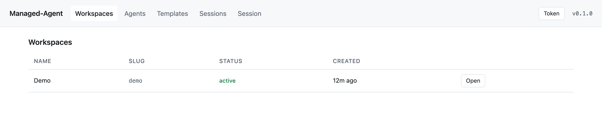

Click **Open** to drop into a workspace's agents.

### 5.2 Agents & quota

An agent is a named, versioned configuration (prompt, model, tool policy, sandbox spec).
The Agents view shows the workspace's live quota as cards across the top, then each agent
with its latest version, production pin and status.

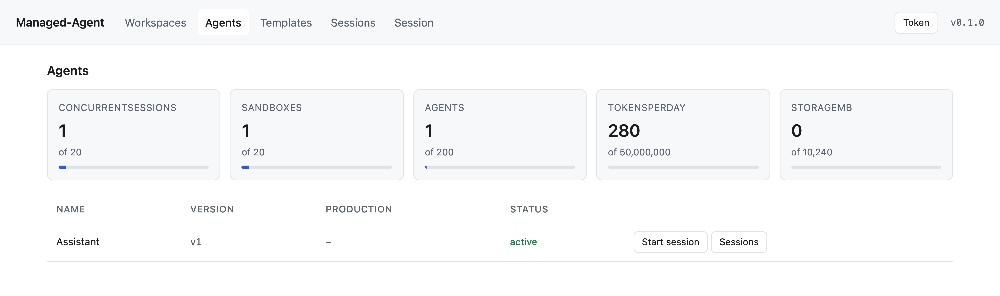

- **Quota cards** — each is *used of limit* with a meter:
  - **ConcurrentSessions** and **Sandboxes** — sessions that hold a sandbox right now.
  - **Agents** — agents in the workspace.
  - **TokensPerDay** — model tokens used today.
  - **CostPerDay** — what today's model calls cost, in **micro-dollars** (31,390 is about
    $0.03). A limit of **0 means no cost cap**; set one to stop spending at a ceiling.
  - **StorageMb** — artifacts, uploads included.
  - **KnowledgeChunks** — indexed chunks across the workspace's datasets.
- **Version / Production** — *Sales analyst* has two versions and its production pin is on
  v2, so new sessions run v2. An agent with no pin (–) runs its latest version.
- **Start session** — provisions a sandbox and opens the new session's detail view.
- **Sessions** — lists just this agent's sessions.

### 5.3 Templates

Templates are parameterized agent blueprints. The platform ships four built-ins; you can
add your own per workspace. Each row shows its category, whether it is built-in or
workspace-defined, and the variables it takes.

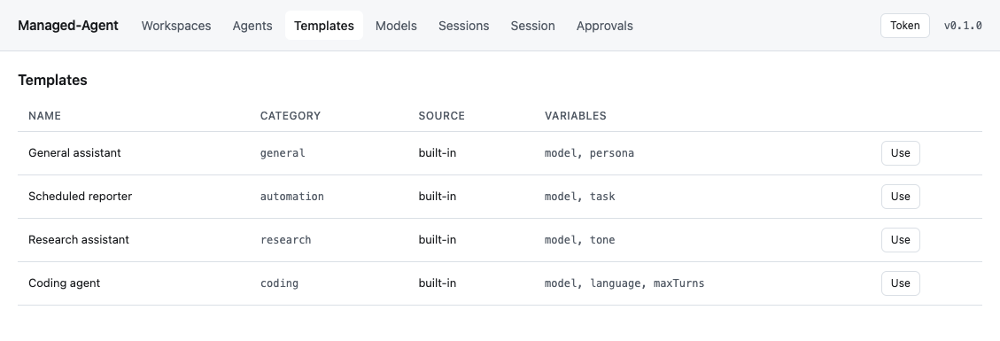

Click **Use** to instantiate a template into a new agent — the console prompts for each
variable the template declares. *Helpdesk assistant* above came from **General assistant**
with `model` and `persona` filled in.

### 5.4 Models

The Models view is the platform's model catalogue: what agents may call, each tagged
**free** or **paid**, with its context window and whether it can call tools. The platform
holds every provider credential and makes the calls itself; free models cost nothing.

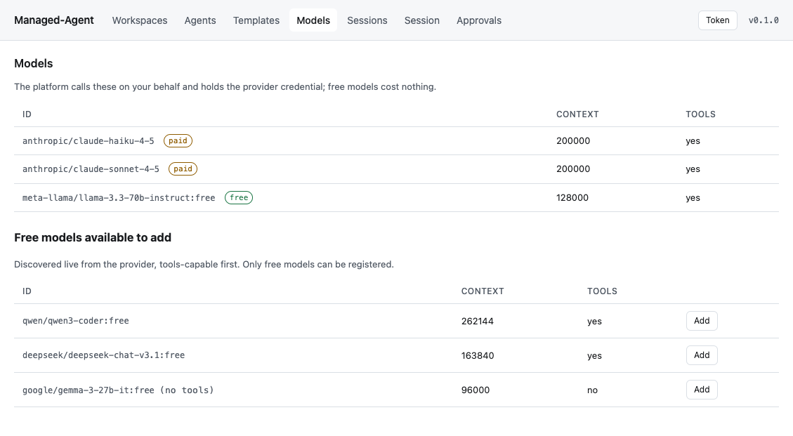

- **The catalogue** (top) — here two Claude models from the Anthropic provider and one free
  Llama model from OpenRouter. A workspace sees only models it is allowed to use.
- **Free models available to add** (bottom) — what OpenRouter offers for free right now,
  fetched live and listed tools-capable first. A model counts as free only if every price
  it lists is zero. **Add** registers one into the catalogue; it needs a platform admin. A
  model that cannot call tools (*no tools*) can chat but cannot run the agent's tools.

### 5.5 Sessions

A session is one conversation with an agent. The Sessions view lists them with status,
resolved version, turn count, token usage and last activity.

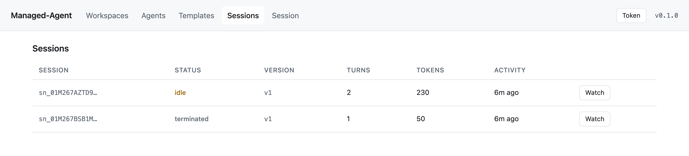

The two `running` sessions with 0 turns are the *Release manager*'s: each is paused in its
first turn, waiting for someone to approve a tool call
([Approving a tool call](#511-approving-a-tool-call)). Click **Watch** to open a session.

### 5.6 A live session

The Session view is where an operator actually sits. It shows the session's identity and
running totals, live controls, a message composer, a log search, and the full event log —
updated live over a server-sent-events stream.

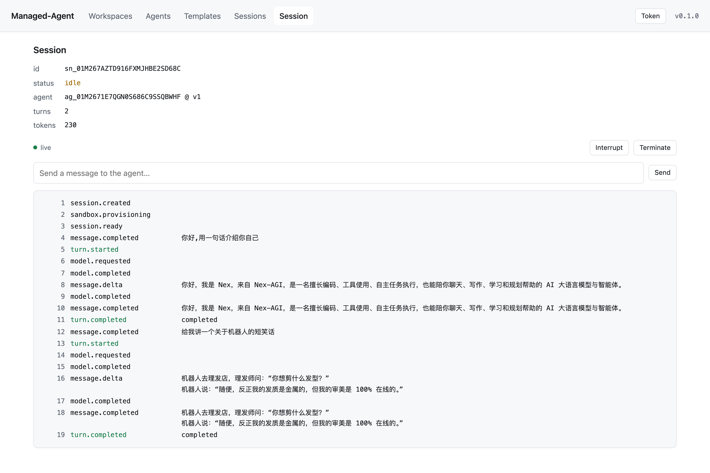

- **Header** — `id`, `status` (here `idle`: it has finished a turn and waits for the next),
  the resolved `agent @ version`, `turns` and `tokens`. These update as turns complete.
- **model** — the model this session calls, tagged free or paid, with the fallbacks the
  version declares, and **Change** ([Changing the model](#59-changing-the-model-for-one-session)).
- **`live` indicator** — green when the event stream is connected.
- **Interrupt** — stops the current turn.
- **Terminate** — ends the session and releases its sandbox (irreversible; the console asks
  for confirmation first).
- **Composer** — type a message and **Send**. **Attach files** picks files to go with it
  ([Giving the agent files](#57-giving-the-agent-files)).
- **Event log** — every event in order: `session.created → sandbox.provisioning →
  session.ready`, then per turn `turn.started → model.requested → message.delta →
  model.completed → message.completed → turn.completed`, with `tool.*` lines when the
  agent uses a tool. Each `model.completed` shows the model, its latency and the tokens it
  produced; a failover names the model it fell back from.

Line 12 shows a message that went out with a file attached (`attached: sales.csv (192 B)`);
lines 18–23 are the agent reading it with `read_file`.

### 5.7 Giving the agent files

**Attach files** next to **Send** picks up to 10 files for the next message. The line under
the composer lists them, each with **Remove**:

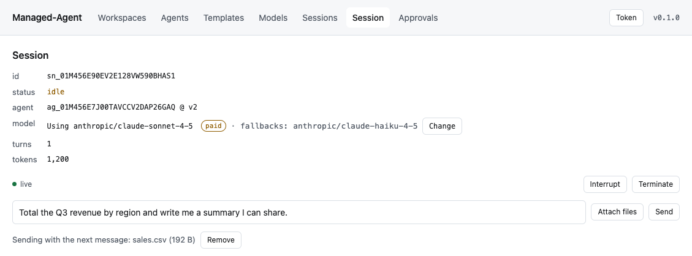

When you send, the console uploads each file to the session and attaches it to the
message. Before the turn starts the sandbox has it at `attachments/sales.csv` in its working
directory, and the prompt tells the agent so. The message's log line lists what it
carried.

- Each file is at most `MA_ARTIFACT_MAX_MB` (25 MB by default) and counts against the
  workspace's storage quota.
- The agent reads text files directly. A PDF or another binary format needs a tool that
  understands it — a shell command the sandbox has, or a skill.
- The session keeps its files: a sandbox rebuilt for it later (after a model change or a
  recovery) gets them back under the same names.

### 5.8 Getting files back

The agent is told to put files meant for you in `outputs/`. Whatever is there when a turn
ends is stored as an artifact of the session *before* the turn is reported ended, and
appears in the log as an `artifact.created` line with a **Download** button:

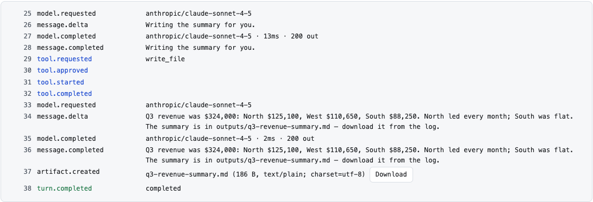

Here the agent wrote `outputs/q3-revenue-summary.md` with `write_file` (lines 29–32), and
line 37 is the stored file: name, size, content type and **Download**. A file is stored
again only when it changed; hidden files (names starting with a dot) and links are not
stored, and a turn stores at most 50 files.

A file that cannot be kept is not dropped silently. It is an `artifact.failed` line, in red,
that says why:

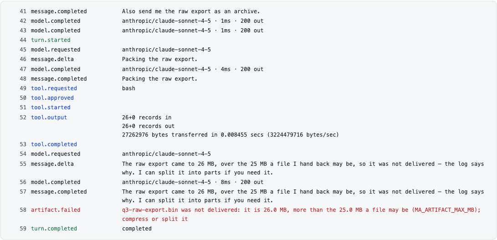

The agent produced a 26 MB file, over the 25 MB limit, so line 58 explains it was not
delivered and what to do (compress or split it). A file over the workspace's storage quota
is reported the same way.

### 5.9 Changing the model for one session

A session runs the model its agent version names. **Change** on the model row picks another
catalogued model **for this session only** — the agent and its other sessions are
untouched:

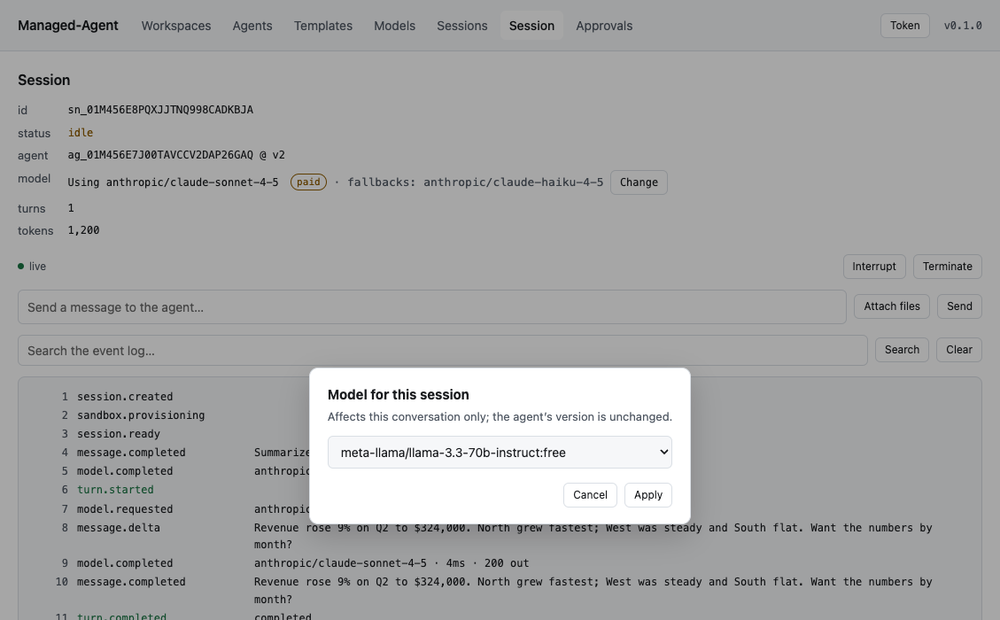

The list holds the version's default and every model the workspace may use. **Apply** takes
effect on the running sandbox; the next turn runs on the new model:

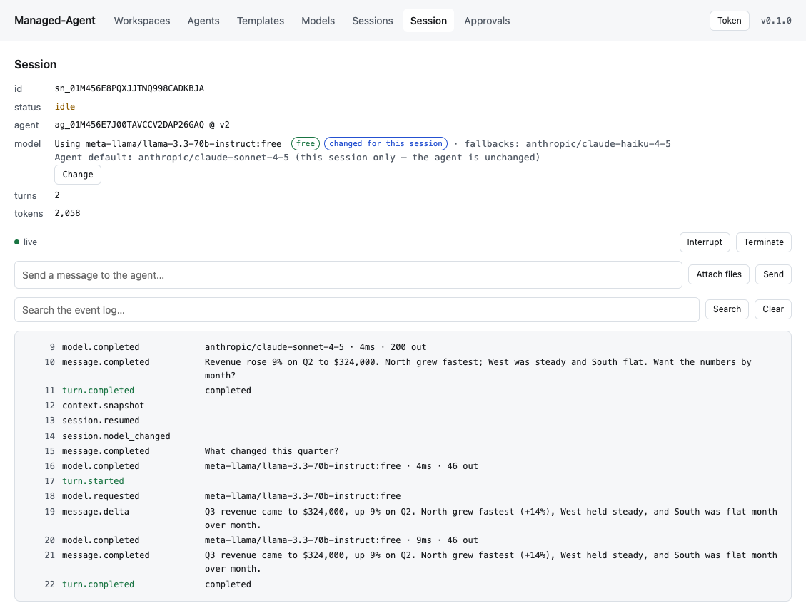

The model row now reads **changed for this session** and shows the agent's default
underneath. The log records `session.model_changed` (line 14), and the following turn's
`model.requested` and `model.completed` name the new model. Pick *Version default* to go
back.

- Changing the model needs the developer role — the same bar as setting a model on a
  version, since it changes what a run costs.
- It is refused with `409 CONFLICT` while a turn is running; change it between turns.
- If the chosen model is later removed from the catalogue or from the workspace's
  allow-list, the session falls back to the version's model rather than calling it.

### 5.10 Searching the log

The search box above the log finds events in the session's whole history, not only the
part on screen. It matches text case-insensitively anywhere in an event's data, so a match
can be in a field the log line does not show (here a tool call's result, lines 16 and 24):

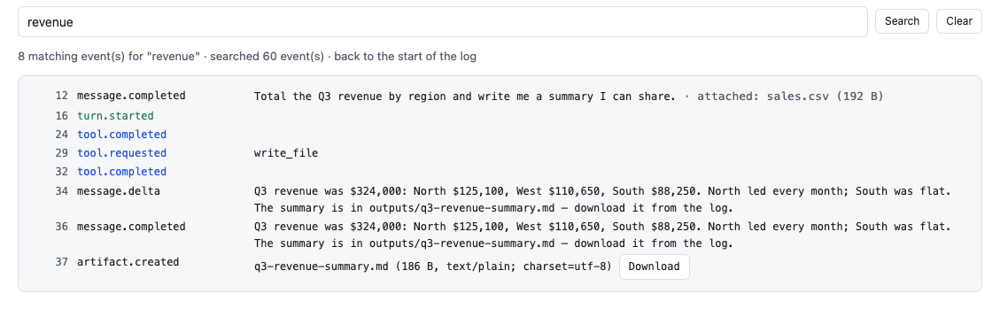

The status line says how many events matched and how far back the search went; a long log
offers **Search older** to carry on. While a search is shown the live stream is paused —
**Clear** returns to the live log.

### 5.11 Approving a tool call

An agent whose tool policy is `prompt` asks before running a tool its policy does not
already allow. While it waits, the session shows the call above its log under
**Waiting for you**:

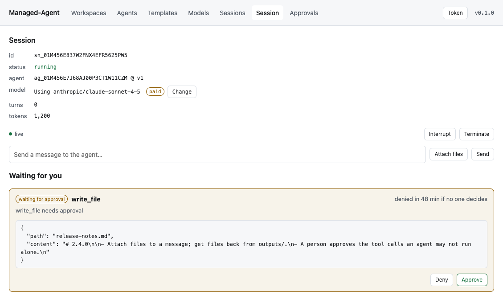

The card shows the tool (`write_file`), the exact arguments it would run with, the policy's
reason, and how long until it is denied if nobody answers (this agent waits up to an hour,
`tools.approvalTimeoutSeconds: 3600`; the default is 10 minutes). The session stays
`running` and its turn is paused.

- **Approve** runs the call and the turn carries on.
- **Deny** asks why; the agent reads that reason as the call's result and can choose
  another route.

The card appears and clears live — including when someone decides from another console, the
CLI or the API. The log records the request and the decision, with who decided:

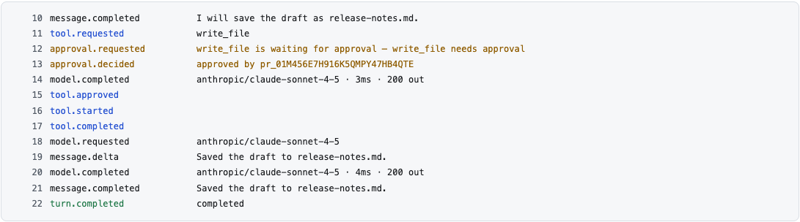

Line 12 is the request, line 13 the decision (`approved by pr_…`), and lines 15–17 the tool
actually running. Deciding needs the operator role or above.

### 5.12 The Approvals queue

The **Approvals** view gathers every call waiting for a person across the workspace, so
nobody has to open sessions one by one to find them:

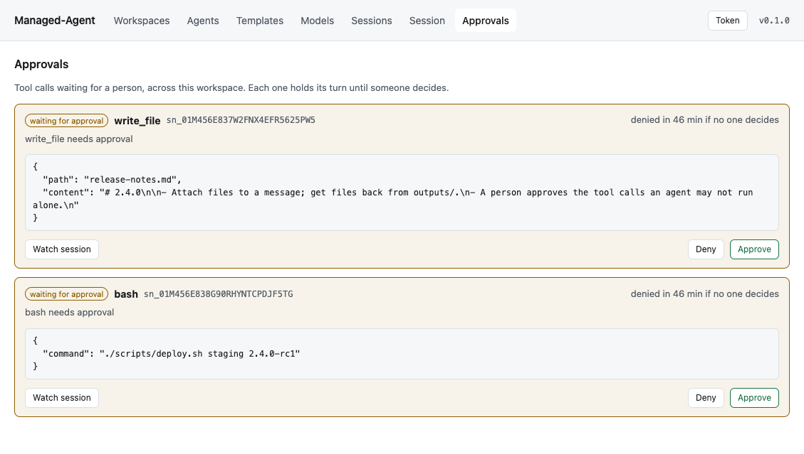

Each card names its session and has the same **Approve** and **Deny** as the session view,
plus **Watch session** to open the conversation it belongs to. A viewer sees the queue but
cannot decide.

### 5.13 A finished session

Once a session is terminated (or has failed), it is shown **read-only**: the indicator reads
`ended`, the controls and composer are gone, and the event log is kept for audit. You can
still search it.

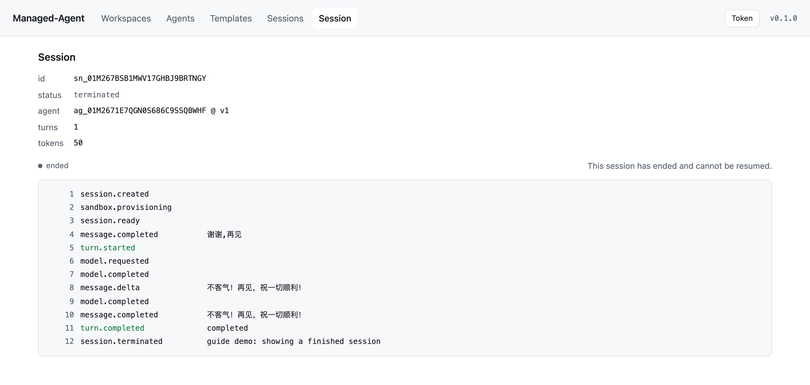

The log ends with `session.terminated` and its reason (`check-in done`), and the header
keeps the final `turns` and `tokens`. A finished session cannot be resumed; start a new one.

---

## 6. Walkthroughs

The walkthroughs use these variables; the [HTTP API](#7-using-the-http-api) section shows how
to find the ids.

```bash
export MA_URL=http://127.0.0.1:8080        # read by the ma CLI
export MA_TOKEN=demo-admin-token
export MA=$MA_URL TOK=$MA_TOKEN             # used by the curl examples
export WS=ws_...                            # your workspace
export AGENT=ag_...                         # your agent
```

`ma` commands that change something print a plan and change nothing until you add `--yes`.

### 6.1 Your first conversation

1. **Open the workspace.** Workspaces → **Open** on *Demo*.
2. **Start a session.** Agents → **Start session** on *Assistant*. The console opens the new
   session; watch it move `queued → provisioning → ready` (the local sandbox spawns in a few
   seconds).
3. **Send a message.** Type into the composer and **Send**. You will see, live:
   `turn.started`, `model.requested`, `message.delta` (streaming), `model.completed`,
   `message.completed`, `turn.completed` — and the header's `turns` and `tokens` tick up.
4. **Keep chatting.** Each message is a new turn in the same session.
5. **Intervene if needed.** **Interrupt** stops a runaway turn; **Terminate** ends the
   session and frees its sandbox.

That single flow exercises the whole chain: provisioning → agent-core → the control plane's
model gateway → the upstream model → the event log.

### 6.2 Have the agent work on a file

1. **Let the agent use the file tools.** Publish a version whose tool policy allows them.
   A published spec is merged into the previous version, so the file needs only what
   changes:

   ```bash
   cat > tools.json <<'EOF'
   { "tools": { "mode": "strict", "allow": ["read_file", "write_file", "list_directory"] } }
   EOF
   ma agent version create --agent $AGENT --spec tools.json --summary "Let it read and write files" --yes
   ```

   Sessions started from now on run the new version (or move the production pin to it with
   `ma agent update --agent $AGENT --production-version N --yes` if the agent has one).
   A running session keeps the version it started with.
2. **Start a session** and, in the composer, **Attach files** → pick `sales.csv`.
3. **Ask for a result as a file:** *"Total the Q3 revenue by region and write me a summary I
   can share."* The agent reads `attachments/sales.csv`, writes `outputs/…`, and answers.
4. **Download it.** The `artifact.created` line has **Download**
   ([Getting files back](#58-getting-files-back)). Or from the command line:

   ```bash
   ma artifact list --workspace $WS --session sn_...
   ma artifact get --artifact ar_... --out q3-revenue-summary.md
   ```

The same from the CLI, attachment included:

```bash
ma session create --agent $AGENT --title "Q3 sales review" --yes
echo "Total the Q3 revenue by region and write me a summary I can share." > ask.txt
ma session send --session sn_... --prompt-file ask.txt --attach sales.csv --yes
ma session watch --session sn_... --types turn.,artifact.
```

### 6.3 An agent that asks before it acts

1. **Put the agent in `prompt` mode.** Tools it allows still run without asking; everything
   else waits for a person:

   ```bash
   cat > ask-first.json <<'EOF'
   { "tools": { "mode": "prompt", "allow": ["read_file", "list_directory"], "approvalTimeoutSeconds": 3600 } }
   EOF
   ma agent version create --agent $AGENT --spec ask-first.json --summary "Ask before writing or running commands" --yes
   ```

2. **Start a session and ask for something that writes**, e.g. *"Draft the release notes for
   2.4 and save them."* The turn pauses and the session shows **Waiting for you**
   ([Approving a tool call](#511-approving-a-tool-call)).
3. **Decide** in the session, in the **Approvals** view, or from the CLI:

   ```bash
   ma approval list --workspace $WS --status pending
   ma approval show --session sn_... --approval ap_...
   ma approval approve --session sn_... --approval ap_... --yes
   ma approval deny --session sn_... --approval ap_... --reason "not on production" --yes
   ```

Things to know:

- A session started by a connector or a schedule has no one to ask, so a call that would
  need approval is denied at once. Give unattended agents a `strict` policy with an
  explicit allow-list.
- A call nobody decides within `approvalTimeoutSeconds` is denied as expired; the turn's own
  deadline (`turnTimeoutSeconds`, 30 minutes by default) still applies on top.
- The wait survives a control-plane restart and a dropped browser connection.

### 6.4 Run an agent on a schedule

A schedule is a connector of type `schedule`: it submits a prompt to the agent on a cron.

```bash
cat > schedule.json <<'EOF'
{
  "cron": "0 8 * * 1-5",
  "timezone": "Europe/Berlin",
  "prompt": "Summarise yesterday's sales and flag any region that dropped more than 10%.",
  "skipIfRunning": true
}
EOF
ma connector create --workspace $WS --type schedule --name "Morning sales digest" \
  --external-key morning-digest --agent $AGENT --config schedule.json --yes
ma connector activate --connector cn_... --yes      # needs the admin role
ma connector next-fire --connector cn_...           # when it will run next
ma connector run --connector cn_... --yes           # fire it once now, to try it
ma connector receipts --connector cn_...            # one receipt per fire
```

- `cron` has five fields and is evaluated in `timezone` (default `UTC`), correctly across
  daylight-saving changes.
- `skipIfRunning` (default `true`) skips a fire while the previous run is still going.
- `misfireGraceSeconds` (default 300) skips a fire that comes this much later than
  scheduled, e.g. after the server was down, instead of running it late.
- A connector starts as `draft` and receives nothing until it is activated.

Each fire starts a new session by default; see [session policies](#109-connectors) to reuse
one. If a schedule did not fire, see
[Operations → A schedule that did not fire](operations.md#a-schedule-that-did-not-fire).

### 6.5 Start an agent from a webhook

A webhook connector turns a signed HTTP request into a message to an agent.

1. **Store the signing secret** as a credential (any type; its value is the secret):

   ```bash
   openssl rand -hex 32 > webhook-secret.txt
   ma credential create --workspace $WS --name support-webhook --type api_key \
     --value-file webhook-secret.txt --yes
   ```

2. **Create and activate the connector:**

   ```bash
   ma connector create --workspace $WS --type webhook --name "Support tickets" \
     --external-key support-tickets --agent $AGENT \
     --session-policy reuse_per_scope --secret-credential cr_... --yes
   ma connector activate --connector cn_... --yes
   ```

3. **Send a signed request** to `/ingress/v1/{workspaceId}/{externalKey}`. The signature is
   the hex HMAC-SHA256 of `{timestamp}.{raw body}` with the secret, and the timestamp is in
   epoch **milliseconds**, within 5 minutes of the server's clock:

   ```bash
   BODY='{"prompt":"Summarise ticket #4821 and suggest a reply.","eventId":"ticket-4821","scope":"ticket-4821"}'
   TS=$(( $(date +%s) * 1000 ))
   SIG=$(printf '%s.%s' "$TS" "$BODY" | openssl dgst -sha256 -hmac "$(cat webhook-secret.txt)" -hex | sed 's/^.* //')
   curl -s -X POST -H 'content-type: application/json' \
     -H "x-ma-timestamp: $TS" -H "x-ma-signature: $SIG" \
     --data "$BODY" "$MA/ingress/v1/$WS/support-tickets"
   # {"status":"accepted","receiptId":"rc_..."}   (202)
   ```

The body's `prompt` is the message (without one, the whole JSON body is sent). `eventId`
makes retries safe: the same id is reported as a duplicate (200) with the original receipt
rather than starting a second run. With `reuse_per_scope`, every request with the same
`scope` continues the same session — here, one conversation per ticket. A bad signature or
a stale timestamp is refused with `401 DELIVERY_REJECTED`.

Slack, Feishu, SQS and Kafka are set up the same way with their own config; see
[Operations → Connecting Slack or Feishu](operations.md#connecting-slack-or-feishu) and
[Connecting a queue or a topic](operations.md#connecting-a-queue-or-a-topic-sqs-kafka).

### 6.6 Give an agent a knowledge base

```bash
ma dataset create --workspace $WS --name "Pricing policies" --yes
ma dataset add-document --dataset ds_... --name discounts.md --content-file discounts.md \
  --content-type text/markdown --yes
ma dataset documents --dataset ds_...                # wait for the document to be indexed
ma dataset bind --agent $AGENT --datasets ds_... --yes
```

Binding publishes a new agent version that lists the dataset (the agent needs a version
already; if it has a production pin, move the pin to the new version). Sessions on it get a
`search_knowledge` tool that searches only the datasets bound to their version; allow it
in the tool policy if the policy is `strict`. Search is keyword-based (BM25), not semantic.

---

## 7. Using the HTTP API

The API is under `/v1` and every request carries a bearer token. The full, generated
specification is served at `GET /openapi.json`.

```bash
export MA=http://127.0.0.1:8080
export TOK=demo-admin-token
```

### Discover a workspace and its agent

```bash
curl -s -H "authorization: Bearer $TOK" "$MA/v1/workspaces"
curl -s -H "authorization: Bearer $TOK" "$MA/v1/workspaces/$WS/agents"
```

### Start a session, send a message, read the log

```bash
# Create a session
SID=$(curl -s -X POST -H "authorization: Bearer $TOK" -H 'content-type: application/json' \
  -d "{\"agentId\":\"$AGENT\"}" "$MA/v1/sessions" | jq -r .session.id)

# Wait a few seconds for it to reach 'ready', then send a message
curl -s -X POST -H "authorization: Bearer $TOK" -H 'content-type: application/json' \
  -d '{"events":[{"type":"user.message","text":"Hello!"}]}' \
  "$MA/v1/sessions/$SID/events"

# Read the event log (add &q=revenue to search it, &types=tool.,turn. to filter)
curl -s -H "authorization: Bearer $TOK" "$MA/v1/sessions/$SID/events?limit=100"
```

### Hand the agent a file

Upload the file to the session — the body is the file as it is, the name goes in the query
string — then name the artifact it returns in a message's `attachments`:

```bash
FILE=$(curl -s -X POST -H "authorization: Bearer $TOK" -H 'content-type: application/octet-stream' \
  --data-binary @sales.csv "$MA/v1/sessions/$SID/files?name=sales.csv" | jq -r .artifact.id)

curl -s -X POST -H "authorization: Bearer $TOK" -H 'content-type: application/json' \
  -d "{\"events\":[{\"type\":\"user.message\",\"text\":\"Total the sales by region.\",\"attachments\":[\"$FILE\"]}]}" \
  "$MA/v1/sessions/$SID/events"
```

Before the turn starts the sandbox has the file at `attachments/sales.csv`. Two files of one
name in a session are numbered, `sales (2).csv`.

- An upload is an artifact of the session, charged to the workspace's storage and capped at
  `MA_ARTIFACT_MAX_MB`. The same bytes under the same name are stored once.
- Uploading needs `session.send`. Attaching needs `artifact.download` on the file as well,
  because it hands the content to the agent — and so to anyone who can read the session.
- A message can attach any available artifact of the session's workspace, including one an
  earlier session produced; not one from another workspace, and at most 10 per submission.

### Get files back

```bash
curl -s -H "authorization: Bearer $TOK" "$MA/v1/workspaces/$WS/artifacts?sessionId=$SID"
curl -s -H "authorization: Bearer $TOK" -o report.md "$MA/v1/artifacts/$ARTIFACT/content"
```

Each stored file is an `artifact.created` event on the session's log, with its `artifactId`;
once you see `turn.completed`, that turn's files are already stored. This is the built-in
runtime's convention; a command runtime stores files itself with
`POST /runtime/v1/artifacts` (see the [runtime protocol](runtime-protocol.md)).

### Approve or deny a tool call

```bash
curl -s -H "authorization: Bearer $TOK" "$MA/v1/workspaces/$WS/approvals?statuses=pending"

curl -s -X POST -H "authorization: Bearer $TOK" -H 'content-type: application/json' \
  -d '{"decision":"deny","reason":"use the staging cluster"}' \
  "$MA/v1/sessions/$SID/approvals/$APPROVAL/decision"
```

A decision on an approval that is already settled (decided, expired or cancelled) answers
`409`.

### Change a session's model

```bash
curl -s -X PUT -H "authorization: Bearer $TOK" -H 'content-type: application/json' \
  -d '{"modelId":"meta-llama/llama-3.3-70b-instruct:free"}' "$MA/v1/sessions/$SID/model"
# {"modelId": null} goes back to the version's model
```

### Live event stream (SSE)

```bash
curl -N -H "authorization: Bearer $TOK" -H 'accept: text/event-stream' \
  "$MA/v1/sessions/$SID/events/stream?fromSeq=0"
```

Each frame's `id` is the event's sequence number, so a reconnecting client (a browser's
`EventSource` does this itself) resumes with no gap and no duplicate.

### Interrupt / terminate / renew

```bash
curl -s -X POST -H "authorization: Bearer $TOK" -H 'content-type: application/json' \
  -d '{"reason":"stop"}' "$MA/v1/sessions/$SID/interrupt"

curl -s -X POST -H "authorization: Bearer $TOK" -H 'content-type: application/json' \
  -d '{"reason":"done"}' "$MA/v1/sessions/$SID/terminate"
```

### Connectors and datasets

```bash
# A webhook connector (starts as draft), then activate it
curl -s -X POST -H "authorization: Bearer $TOK" -H 'content-type: application/json' \
  -d "{\"type\":\"webhook\",\"name\":\"Support tickets\",\"externalKey\":\"support-tickets\",\"agentId\":\"$AGENT\",\"sessionPolicy\":\"reuse_per_scope\",\"secretCredentialId\":\"$CRED\",\"config\":{}}" \
  "$MA/v1/workspaces/$WS/connectors"
curl -s -X POST -H "authorization: Bearer $TOK" -H 'content-type: application/json' \
  -d '{"status":"active"}' "$MA/v1/connectors/$CONNECTOR/status"

# A dataset with one document, bound to an agent
curl -s -X POST -H "authorization: Bearer $TOK" -H 'content-type: application/json' \
  -d '{"name":"Pricing policies"}' "$MA/v1/workspaces/$WS/datasets"
curl -s -X POST -H "authorization: Bearer $TOK" -H 'content-type: application/json' \
  -d '{"name":"discounts.md","contentType":"text/markdown","content":"Volume discounts start at 50 seats."}' \
  "$MA/v1/datasets/$DATASET/documents"
curl -s -X PUT -H "authorization: Bearer $TOK" -H 'content-type: application/json' \
  -d "{\"datasetIds\":[\"$DATASET\"]}" "$MA/v1/agents/$AGENT/datasets"
```

### Selected endpoints

| Method & path | Purpose |
|---|---|
| `GET /health` | Liveness (`{"status":"ok","version":"..."}`) |
| `GET /openapi.json` | The API's OpenAPI document |
| `GET /v1/workspaces` · `POST /v1/workspaces` | List / create workspaces |
| `PUT /v1/workspaces/:id/members` | Set members and roles (send the ETag as `If-Match` to avoid overwriting a concurrent edit) |
| `GET /v1/workspaces/:id/grants` · `POST` · `DELETE …/:grantId` | Resource-scoped grants |
| `GET /v1/workspaces/:id/quota` | Quota limits & usage |
| `GET /v1/workspaces/:id/usage` | Daily usage and cost history |
| `GET /v1/workspaces/:id/agents` · `POST` | List / create agents |
| `POST /v1/agents/:id/versions` | Publish a new agent version (merged into the previous one unless `replace`) |
| `POST /v1/agents/:id/archive` | Archive an agent |
| `GET /v1/workspaces/:id/templates` | List templates |
| `POST /v1/workspaces/:id/templates/:tid/instantiate` | Create an agent from a template |
| `POST /v1/sessions` · `GET /v1/sessions` | Start / list sessions (`?workspaceId=` or `?agentId=`) |
| `GET /v1/sessions/:id` | Session detail |
| `POST /v1/sessions/:id/events` | Submit user events |
| `POST /v1/sessions/:id/files?name=` | Upload a file for the agent (raw body); attach the returned artifact's id to a message |
| `GET /v1/sessions/:id/events` | Read the event log (`fromSeq`, `toSeq`, `types`, `order`, `q` to search) |
| `GET /v1/sessions/:id/events/stream` | Live SSE stream |
| `POST /v1/sessions/:id/interrupt` · `terminate` · `renew` | Stop the turn / end the session / extend its lease |
| `PUT /v1/sessions/:id/model` | Use another catalogued model for this session only (`{"modelId": null}` clears it); 409 while a turn is running |
| `GET /v1/sessions/:id/approvals` | Tool calls this session waited on a person for (`?statuses=pending` for the ones still waiting) |
| `POST /v1/sessions/:id/approvals/:aid/decision` | Approve or deny a waiting call (`{"decision":"approve"\|"deny","reason":"…"}`); 409 once it is settled |
| `GET /v1/workspaces/:id/approvals` | The workspace's approval queue (`?statuses=pending`) |
| `GET /v1/workspaces/:id/artifacts` | Files agents produced and files uploaded for them (`?sessionId=`) |
| `GET /v1/artifacts/:id/content` | Download an artifact |
| `GET /v1/workspaces/:id/credentials` · `POST` | List credentials (metadata only) / create one (write-only value) |
| `GET /v1/workspaces/:id/connectors` · `POST` | List / create connectors |
| `POST /v1/connectors/:id/status` · `run` | Activate, disable or archive / fire a schedule now |
| `GET /v1/connectors/:id/receipts` · `POST /v1/receipts/:id/retry` | Delivery receipts / replay one |
| `POST /ingress/v1/:workspaceId/:externalKey` | Inbound delivery for a webhook or bot connector |
| `GET /v1/workspaces/:id/datasets` · `POST` | List / create datasets |
| `POST /v1/datasets/:id/documents` | Add a document |
| `PUT /v1/agents/:id/datasets` | Bind datasets to an agent |
| `GET /v1/workspaces/:id/memories` | List memories |
| `POST /v1/memories/:id/promote` | Allow a memory into the system prompt, or withdraw it |
| `GET /v1/workspaces/:id/audit` · `GET /v1/audit/verify` | Audit log / verify the hash chain |
| `GET /v1/models` | Models this caller may use |
| `GET /v1/models/free` | Free models the configured provider offers now, tools-capable first |
| `POST /v1/models/free` | Register one of them into the catalogue (platform admin, `model.register` scope) |

---

## 8. Using the TypeScript SDK

`@ma/sdk` (in `packages/sdk`) is a typed client for browsers and Node. It retries what is
safe to retry, and its event stream resumes by itself after a dropped connection.

```ts
import { readFile } from 'node:fs/promises';
import { ManagedAgentClient } from '@ma/sdk';

const client = new ManagedAgentClient({ baseUrl: 'http://127.0.0.1:8080', token: process.env.MA_TOKEN! });

const { session } = await client.createSession({ agentId: 'ag_...', title: 'Q3 sales review' });

// Hand the agent a file and ask for a result.
const { artifact } = await client.uploadFile(session.id, 'sales.csv', new Uint8Array(await readFile('sales.csv')));
await client.prompt(session.id, 'Total the Q3 revenue by region and write me a summary.', {
  attachments: [artifact.id],
});

// Follow the turn: approve what it asks for, collect what it hands back.
for await (const event of client.streamEvents(session.id)) {
  if (event.type === 'approval.requested') {
    const { approvalId } = event.payload as { approvalId: string };
    await client.approve(session.id, approvalId, 'reviewed by the release bot');
  }
  if (event.type === 'artifact.created') {
    const { artifactId, path } = event.payload as { artifactId: string; path: string };
    console.log(path, (await client.downloadArtifact(artifactId)).byteLength, 'bytes');
  }
  if (event.type === 'turn.completed') break;
}
```

The client has a method for every resource in this guide — for example `setSessionModel`,
`listWorkspaceApprovals`, `deny`, `createConnector`, `activateConnector`, `runConnector`,
`createDataset`, `addDocument`, `bindDatasets`, `createMemory`, `instantiateTemplate`,
`listFreeModels` and `listAudit`. `streamEvents` ends on its own when the session reaches
a terminal state, or when the `signal` you pass aborts.

---

## 9. Using the `ma` CLI

The CLI wraps the same API. Point it at your server and token through the environment:

```bash
export MA_URL=http://127.0.0.1:8080
export MA_TOKEN=demo-admin-token          # or --token-file FILE
```

Prefer `MA_TOKEN` or `--token-file`: a `--token` on the command line is visible to other
processes. Secrets (credential values, prompts) are read from files, never from arguments.

**Every command that changes something prints a plan and changes nothing unless you add
`--yes`.** Read commands take `--json` for machine-readable output. `ma --help` lists every
command.

```bash
# Workspaces
ma workspace list
ma workspace create --name "My Team" --slug my-team --yes
ma workspace quota --workspace ws_...

# Agents and versions
ma agent list --workspace ws_...
ma agent create --workspace ws_... --name Assistant --spec spec.json --yes
ma agent version create --agent ag_... --spec patch.json --summary "Allow file tools" --yes
ma agent version list --agent ag_...
ma agent update --agent ag_... --production-version 2 --yes

# Sessions
ma session create --agent ag_... --title "Support chat" --yes
ma session send --session sn_... --prompt-file prompt.txt --attach sales.csv,notes.txt --yes
ma session watch --session sn_... --types turn.,message.,artifact.
ma session events --session sn_... --q revenue --order desc --limit 50
ma session model --session sn_... --model meta-llama/llama-3.3-70b-instruct:free --yes
ma session model --session sn_... --clear --yes
ma session renew --session sn_... --ttl 3600 --yes
ma session terminate --session sn_... --reason "done" --yes

# Approvals
ma approval list --workspace ws_... --status pending
ma approval show --session sn_... --approval ap_...
ma approval approve --session sn_... --approval ap_... --yes
ma approval deny --session sn_... --approval ap_... --reason "not on production" --yes

# Files
ma artifact list --workspace ws_... --session sn_...
ma artifact get --artifact ar_... --out report.md

# Models
ma model list --workspace ws_...
ma model free                                   # what the provider offers for free now
ma model free-add --model qwen/qwen3-coder:free --yes

# Connectors and deliveries
ma connector create --workspace ws_... --type schedule --name Digest --external-key digest \
  --agent ag_... --config schedule.json --yes
ma connector activate --connector cn_... --yes
ma connector run --connector cn_... --yes
ma connector receipts --connector cn_... --statuses failed
ma receipt retry --receipt rc_... --reason "upstream was down" --yes

# Knowledge bases
ma dataset create --workspace ws_... --name "Pricing policies" --yes
ma dataset add-document --dataset ds_... --name faq.md --content-file faq.md --yes
ma dataset bind --agent ag_... --datasets ds_... --yes

# Templates
ma template list --workspace ws_...
ma template instantiate --workspace ws_... --template at_... --name NewAgent --variables vars.json --yes

# Credentials (value read from a file, never shown again)
ma credential create --workspace ws_... --name OPENAI --type env_vars --value-file secret.json --yes
ma credential list --workspace ws_...

# Memories
ma memory add --workspace ws_... --content "Deploys need a change ticket" --yes
ma memory list --workspace ws_... --injectable-only
ma memory promote --memory me_... --yes

# Audit
ma audit list --workspace ws_... --limit 50
```

---

## 10. Concepts reference

### 10.1 Session lifecycle

A session moves through a small state machine:

```
queued ─► provisioning ─► ready ─► running ─► idle
   │            │           │  ▲       │  │      │
   │            │           │  └───────┘  │      │  (idle ⇄ running per turn)
   │            │           └─────────────┴──────┴──► terminating ─► terminated
   └────────────┴──────────────────────────────────────────────────► failed
```

- **queued** — admitted, waiting for a sandbox (this is where quota backpressure waits
  visibly).
- **provisioning** — a sandbox is being acquired.
- **ready** — holds a sandbox, has not yet run a turn.
- **running** — a turn is in progress (including a turn paused on an approval).
- **idle** — has served at least one turn and is waiting for the next.
- **terminating** — shutting down and releasing its sandbox.
- **terminated / failed** — terminal. A terminal session is read-only; it cannot be
  interrupted, messaged, or resumed.

A session that loses its sandbox (`sandbox.lost`) gets a new one within its lease and
resumes the conversation from its last snapshot rather than starting over.

### 10.2 Agent versions & the agent spec

Agents are versioned, and versions are immutable. A session **resolves its version once, at
creation**, and is then immune to later edits — publishing v2 never changes what an
already-running session executes, except that an idle session can be rolled onto a new
production version between turns. An agent can have a **production pin**; new sessions use
the pin, else the latest version. Version 0 means the agent has no versions yet and cannot
run.

A version's spec holds:

| Field | What it sets |
|---|---|
| `systemPrompt` | The agent's instructions |
| `model` | `modelId` and optional `fallbackModelIds` for failover |
| `tools` | The tool policy: `mode`, `allow`, `deny`, `allowedCommands`, `deniedCommands`, `approvalTimeoutSeconds` ([below](#103-tool-policies--approvals)) |
| `context` | When to compact the conversation, how much to keep verbatim, how often to snapshot |
| `sandbox` | Image, resources, network policy, mounts, setup commands |
| `runtime` | `builtin` (default) or `command` — your own process speaking the [runtime protocol](runtime-protocol.md) |
| `skills`, `plugins`, `mcpServers`, `subAgents` | Extra capabilities ([below](#1012-skills-plugins-mcp-servers--sub-agents)) |
| `credentialIds`, `datasetIds` | Credentials the sandbox receives; datasets its retrieval tool searches |
| `maxTurnsPerSession`, `turnTimeoutSeconds` | Limits: 200 turns, 30 minutes per turn by default |

Publishing merges the spec you send into the previous version and returns what changed, so
a field you left out is not silently dropped; send `replace: true` (`--replace`) to write a
complete spec instead.

### 10.3 Tool policies & approvals

Every tool call is checked against the version's tool policy before it runs:

| `mode` | A tool not in `allow` |
|---|---|
| `strict` (default) | is denied — the right default for unattended agents |
| `prompt` | waits for a person to approve or deny it |
| `auto` | runs, unless it is in `deny` |
| `plan` | runs only if it is read-only; nothing that modifies state runs |

- `deny` always wins, in every mode.
- Shell commands get a second check: `deniedCommands` and `allowedCommands` match command
  prefixes (a non-empty `allowedCommands` is enforced even in `auto` mode). Compound
  commands (`;`, `&&`, pipes, substitutions) and wrappers that run another program
  (`sh -c`, `env`, `xargs`) are refused rather than guessed at.
- Every denial names the rule that refused it, and the agent reads that as the call's
  result, so it can choose a permitted route.
- The built-in tools are `read_file`, `write_file`, `list_directory`, `search` and `bash`;
  skills, plugins, MCP servers and datasets add their own.

**Approvals** (`prompt` mode): the call becomes an approval on the session, shown in the
console and listed by the API and CLI. Someone with the operator role or above approves or
denies it; denied, the agent reads the reason. A session started by a connector or
schedule is denied at once (there is nobody to ask); a call nobody decides within
`approvalTimeoutSeconds` (default 600) is denied as expired. The request, the decision and
who made it are on the session log and in the audit trail. More in
[Operations → Asking a person before a tool runs](operations.md#asking-a-person-before-a-tool-runs).

### 10.4 Files in and out

- **In:** a file uploaded to a session and attached to a message is at
  `attachments/<name>` in the sandbox before the turn starts, digest-checked. A sandbox
  reads only files attached to its own session. A rebuilt sandbox gets the session's files
  back.
- **Out:** files the agent leaves in `outputs/` are stored as artifacts when the turn ends,
  each announced by `artifact.created` (with its `artifactId`) or, if it could not be kept,
  `artifact.failed` with the reason.
- Both directions are capped at `MA_ARTIFACT_MAX_MB` per file and count against the
  workspace's storage quota. Artifacts are deduplicated by content and swept after
  `MA_ARTIFACT_RETENTION_DAYS`.

### 10.5 The event log

Every session has an append-only, gap-free, sequence-numbered event log. It is the audit
trail and the resume mechanism: a client reconnects by asking for events
`fromSeq = last_seen + 1`. Key event types:

- `session.created`, `sandbox.provisioning`, `session.ready`, `session.model_changed`
- `turn.started`, `turn.completed`, `turn.failed`
- `model.requested`, `model.completed`, `model.failed`
- `message.delta` (streaming chunks), `message.completed`
- `tool.requested`, `tool.approved`, `tool.started`, `tool.output`, `tool.completed`
- `approval.requested`, `approval.decided`
- `artifact.created`, `artifact.failed`
- `context.snapshot`, `session.resumed`
- `session.interrupted`, `session.terminated`, `session.failed`, `sandbox.lost`
- `audit.permission.decided`, `audit.credential.accessed`

A state change and its event are always written together, so replaying the log always
reproduces the session row.

### 10.6 Sandboxes & reuse

Each session runs in a sandbox — with the local driver a child process, with the container
or Kubernetes driver a container. A sandbox is created for a session, holds a short
heartbeat-renewed lease, and is released (and destroyed) when the session ends.

Sandbox **reuse** across sessions is limited to genuinely idle sandboxes with an identical
configuration — image, resources, network policy, mounts, setup commands and credentials —
so a warm sandbox never serves a different agent or a rotated secret. Concurrent sessions
of the same agent each get their own sandbox.

### 10.7 Models, providers & failover

- **One catalogue.** Every model, whichever provider serves it, is one catalogue id with a
  price, a context window and whether it can call tools. The gateway refuses a model that
  is not catalogued or that the workspace may not use.
- **Providers.** OpenRouter, Anthropic, Azure OpenAI, AWS Bedrock and Google Vertex AI.
  Each is turned on by listing its models with their prices, e.g.
  `MA_ANTHROPIC_MODELS='claude-sonnet-4-5@3/15/0.3/3.75'` (USD per million input / output /
  cache-read / cache-write tokens). `MA_MODEL_WORKSPACES` reserves a model for named
  workspaces. See [Operations → Native model providers](operations.md#native-model-providers).
- **Free models.** With OpenRouter configured, the Models view and `ma model free` list
  what it offers for free right now; a platform admin adds one with a click or
  `ma model free-add`. Paid OpenRouter models are opt-in (`MA_OPENROUTER_ALLOW_PAID`).
- **Resilience.** A failing call is retried with backoff; a model that keeps failing is
  taken out of rotation by a circuit breaker; then the version's `fallbackModelIds` are
  tried in order — across vendors if you like. Usage is charged to the model that answered,
  and the log says which one did. See
  [Operations → When a model provider is flaky](operations.md#when-a-model-provider-is-flaky).
- **Per session.** A session's model can be switched without touching its agent
  ([Changing the model](#59-changing-the-model-for-one-session)).

### 10.8 Credentials

Credentials are write-only: you supply a value, and thereafter only metadata is readable.
They come in seven types — `api_key`, `oauth_token`, `bearer_token`, `env_vars`, `file`,
`ssh_key`, `basic_auth` — are encrypted at rest, and can be owned by a workspace, an
agent, a session or a person, with an optional expiry. A version lists the credentials its
sandbox receives (`credentialIds`); file and SSH-key values are written to owner-only files,
never into a command line. A connector uses one as its signing secret. Model provider keys
are not credentials of this kind: the platform holds them and no sandbox ever sees them.

### 10.9 Connectors

A connector starts agent runs from outside. Types:

| Type | What starts a run |
|---|---|
| `webhook` | A signed HTTP request to `/ingress/v1/{workspaceId}/{externalKey}` |
| `chat` | A Slack or Feishu message; the answer is posted back in its thread |
| `hook` | A signed request carrying a `callbackUrl`; the result is posted back to it, signed |
| `eventbus` | A CloudEvents feed, filtered by type (`order.*`) and shaped by a prompt template |
| `sqs`, `kafka` | Messages read from a queue or topic |
| `schedule` | A cron expression |

- **Lifecycle:** `draft → active ⇄ disabled → archived`. A connector receives nothing until
  it is activated, which validates its configuration and needs the admin role.
- **Session policy** — which session a delivery goes to: `new_per_event` (default, a new
  session each time), `reuse_per_scope` (one session per scope, e.g. per ticket or per chat
  thread), or `reuse_connector` (one session for the connector).
- **Receipts:** every delivery gets one (`pending → working → succeeded | failed | zombie`),
  keyed so the same event is never run twice. `ma connector receipts` shows them, and
  `ma receipt retry` replays one as a new receipt.

### 10.10 Knowledge bases

A dataset is a set of documents indexed for keyword (BM25) search. Binding datasets to an
agent publishes a version listing them, and its sessions get a `search_knowledge` tool that
searches only those datasets. Indexed chunks count against the workspace's
KnowledgeChunks quota. A request for an embedding model is refused rather than quietly
given keyword search.

### 10.11 Memories

An agent can accumulate **memories**, scoped to the workspace or to one agent. Memories a
person wrote or approved (*injectable*) are added to the system prompt when a sandbox
starts. Memories an agent wrote are reachable only as tool output, never injected
silently, so a hostile web page the agent read cannot dictate its future instructions.
Promoting a memory into the prompt needs the admin role.

### 10.12 Skills, plugins, MCP servers & sub-agents

- **Skills** — instructions and files the agent can load, pinned by content digest.
- **Plugins** — subprocesses that add tools, also digest-pinned.
- **MCP servers** — stdio or HTTP Model Context Protocol servers; `toolAllowlist` limits
  which of their tools the agent sees.
- **Sub-agents** — named helpers with their own prompt and turn limit; a sub-agent's tools
  are the overlap of what it declares and what its parent holds, and it inherits the
  parent's deny rules.

### 10.13 Templates

Templates turn a blueprint plus variables into an agent. The four built-ins cover common
shapes:

| Template | Category | Variables |
|---|---|---|
| General assistant | general | model, persona |
| Scheduled reporter | automation | model, task |
| Research assistant | research | model, tone |
| Coding agent | coding | model, language, maxTurns |

A workspace can add its own with `ma template create`.

### 10.14 Access control

Each workspace member has a role; each role includes the ones below it:

| Role | Can additionally |
|---|---|
| `viewer` | Read workspaces, agents, sessions, logs, connectors, datasets, memories, templates; list artifacts |
| `operator` | Start, message, interrupt and terminate sessions; approve or deny tool calls; download artifacts; read and retry connector receipts |
| `developer` | Create and change agents, versions, templates, connectors, datasets and memories; manage credentials; change a session's model |
| `admin` | Manage members and grants; activate connectors; promote memories; read the audit log and usage; delete agents, datasets, credentials and templates |
| `owner` | Change quotas; archive or delete the workspace |

- **Resource grants** give someone a role on a single agent, dataset, connector, credential
  or template (`POST /v1/workspaces/:id/grants`) — "developer on this one agent" for a
  contractor. Grants only add access; see
  [Operations → Granting access to one resource](operations.md#granting-access-to-one-resource).
- **API keys** can be narrowed to scopes, and a key is held to them even when its owner is
  an admin.
- **SSO** via any OIDC identity provider (`MA_OIDC_PROVIDERS`), with optional mapping from
  IdP groups to workspace roles; **SCIM 2.0** provisioning, where deactivating a user revokes
  every live token at once. See [Operations → Configuration](operations.md#configuration).

### 10.15 Quotas & cost

Each workspace has limits the platform enforces: concurrent sessions, sandboxes, agents,
tokens per day, cost per day (micro-dollars; 0 is no cap), storage, knowledge chunks and
event retention. The Agents view shows usage against each. The cost cap is a hard ceiling:
the worst-case cost of each model call is reserved before the call goes out, so concurrent
calls cannot overshoot it. Exceeding a limit returns `429 QUOTA_EXCEEDED` naming the limit;
see [Operations → Quota refusals](operations.md#quota-refusals) and
[Raising a limit](operations.md#raising-a-limit).

### 10.16 Audit

Security-relevant actions — permission decisions, approvals, credential access, artifact
downloads, model registrations, membership changes — go to the workspace's audit
log (`ma audit list`, admin). Entries form a hash chain, so any edit, insertion, deletion
or reordering is detected and located by `GET /v1/audit/verify`, even by someone with
direct database access. See
[Operations → Verifying the audit log](operations.md#verifying-the-audit-log-has-not-been-tampered-with).

---

## 11. Configuration reference

The server reads configuration from `MA_*` environment variables. The most used are below;
[Operations → Configuration](operations.md#configuration) has the complete list.

| Variable | Default | Purpose |
|---|---|---|
| `MA_PORT` / `MA_HOST` | `8080` / `127.0.0.1` | Where the console and API listen |
| `MA_DATABASE` | `./data/managed-agent.db` | SQLite path, or `:memory:` for an ephemeral DB (the demo sets `:memory:`); Postgres is supported, see operations |
| `MA_BOOTSTRAP_TOKEN` / `MA_BOOTSTRAP_SUBJECT` | — | Pins the first admin token and its subject (else one is generated and printed once) |
| `MA_SANDBOX_DRIVER` | `local` | `local` \| `container` \| `k8s` |
| `MA_SANDBOX_LEASE_SECONDS` / `MA_SANDBOX_PREWARM` | `120` / `0` | Sandbox lease length; warm sandboxes per pool |
| `MA_OPENROUTER_API_KEY` (`_FILE`) / `MA_OPENROUTER_MODELS` | — | OpenRouter key and the models to catalogue (first is the default); `MA_OPENROUTER_ALLOW_PAID` opts into paid ones |
| `MA_ANTHROPIC_MODELS` / `MA_AZURE_OPENAI_MODELS` / `MA_BEDROCK_MODELS` / `MA_VERTEX_MODELS` | — | Turn on a native provider with its models and prices (each has its own key, endpoint or project variables) |
| `MA_MODEL_WORKSPACES` | — | Reserve models for named workspaces |
| `MA_ARTIFACT_ROOT` / `MA_ARTIFACT_MAX_MB` / `MA_ARTIFACT_RETENTION_DAYS` | — / `25` / — | Artifact storage; `MA_ARTIFACT_MAX_MB` caps each file uploaded for an agent and each one it hands back |
| `MA_OIDC_PROVIDERS` and `MA_OIDC_<S>_*` | — | SSO providers |
| `MA_ENCRYPTION_KEYS` / `MA_ENCRYPTION_KEY_VERSION` | — | Credential encryption keys and rotation |
| `MA_EGRESS_PROXY` / `MA_DNS_CIDR` / `MA_INTERNAL_NETWORK` | — | Sandbox network policy |
| `MA_CORS_ORIGINS` / `MA_CONSOLE_ORIGIN` / `MA_PREVIEW_ORIGIN` | — | Cross-origin policy |
| `MA_RATE_LIMIT` / `MA_RATE_WINDOW_MS` | — | API rate limiting |
| `MA_SCHEDULER` / `MA_SCHEDULER_TICK_MS` / `MA_SCHEDULER_BATCH` | on | The background scheduler and reapers |
| `MA_LOG_LEVEL` | `info` | `debug` \| `info` \| `warn` \| `error` |

The demo launcher reads `MA_OPENROUTER_API_KEY` and `MA_OPENROUTER_MODEL` from `.env.demo`;
without a key it uses an offline echo model.

---

## 12. Troubleshooting

**The console asks for a token and nothing loads.**
Paste the token from the launch banner (`demo-admin-token` for the demo). Use the
**Token** button to re-enter it.

**A session sits at `provisioning` for a while.**
With the local driver the sandbox is a child process that takes a few seconds to spawn on
first use. If it never reaches `ready`, the failure is recorded on the session
(`session.failed` with an error) and in the server log; see
[Operations → A session stuck in provisioning](operations.md#a-session-stuck-in-provisioning).

**"Start session" is rejected.**
The agent has no runnable version (version 0). Publish a version first (Templates → Use, or
`ma agent version create`).

**A message send is rejected with a state error.**
The session is not accepting input — it may still be provisioning, or already terminated.
A terminated session is read-only by design; start a new one.

**The agent says it is not allowed to use a tool.**
Its tool policy refused the call, and the log names the rule (`mode:strict`,
`deny:bash`, `command:compound`, …). Allow the tool in a new version, or use `prompt` mode
to approve calls one by one ([Tool policies](#103-tool-policies--approvals)).

**A tool call was denied without anyone deciding.**
Either nobody decided within `approvalTimeoutSeconds` (the result says it expired), or the
session was started by a connector or schedule, where there is no one to ask. Raise the
timeout, or allow the tool for unattended runs.

**An attachment is refused.**
A file over `MA_ARTIFACT_MAX_MB` is refused with `400 PAYLOAD_TOO_LARGE`, one that would
exceed the storage quota with `429 QUOTA_EXCEEDED`, and an upload to a session that has
ended with `412 SESSION_ENDED`. A message takes at most 10 attachments, and only artifacts
of the same workspace.

**A file the agent made did not come back.**
Look for its `artifact.failed` line, which says why — usually over `MA_ARTIFACT_MAX_MB` or
the storage quota. Only files under `outputs/` are collected; hidden files and links are
skipped. Ask the agent to compress or split a large file.

**Changing the model answers 409.**
A turn is running. Wait for `turn.completed` (or **Interrupt**) and change it between turns.

**Calls fail with `MODEL_GATEWAY_UNAVAILABLE`.**
No model provider is configured. Set `MA_OPENROUTER_API_KEY` with a model, or a native
provider's model list, and restart.

**A webhook answers `401 DELIVERY_REJECTED`.**
The signature or timestamp is wrong: sign `{timestamp}.{raw body}` exactly as sent, use a
millisecond timestamp within 5 minutes of the server's clock, and check the connector is
`active` and points at the credential holding that secret.

**A request answers `429 QUOTA_EXCEEDED`.**
A workspace limit is reached; the error names it. The Agents view shows which.

**Two concurrent sessions on the same agent — do they interfere?**
No. Each gets its own sandbox; their event logs are independent.

**Stopping the demo.**
`Ctrl-C` in the `pnpm demo` terminal, or kill the `apps/server/src/demo.ts` process. With
`:memory:` the data is discarded on exit.

---

*Screens may differ slightly as the console evolves; the concepts and lifecycle are
stable.*
