# Managed-Agent 用户手册

[English](user-guide.md) · **简体中文**

这是一份上手手册：逐屏讲解 Web 控制台，介绍 HTTP API、TypeScript SDK 和 `ma` 命令行，并说明每个状态、每类事件是什么意思。

截图来自一个真实运行的实例，服务端、沙箱、控制台都是真的；只有模型换成了预先写好回复的替身，所以回复是固定的，每个流程都能复现。除此之外没有任何摆拍。

控制台界面是英文的，所以文中的按钮和页面名称保留英文原文（如 **Approve**），并配中文说明。文中链接到的运维文档（`operations.md`）目前只有英文版。

---

## 目录

1. [Managed-Agent 是什么](#1-managed-agent-是什么)
2. [一页看懂架构](#2-一页看懂架构)
3. [快速开始：一条命令](#3-快速开始一条命令)
4. [登录控制台](#4-登录控制台)
5. [控制台逐屏讲解](#5-控制台逐屏讲解)
   - [工作区（Workspaces）](#51-工作区workspaces)
   - [Agents 与配额](#52-agents-与配额)
   - [模板（Templates）](#53-模板templates)
   - [模型（Models）](#54-模型models)
   - [会话列表（Sessions）](#55-会话列表sessions)
   - [进行中的会话](#56-进行中的会话)
   - [给 Agent 文件](#57-给-agent-文件)
   - [拿回 Agent 产出的文件](#58-拿回-agent-产出的文件)
   - [只为这个会话换模型](#59-只为这个会话换模型)
   - [搜索日志](#510-搜索日志)
   - [审批一次工具调用](#511-审批一次工具调用)
   - [审批队列（Approvals）](#512-审批队列approvals)
   - [已结束的会话](#513-已结束的会话)
6. [实操演练](#6-实操演练)
   - [第一次对话](#61-第一次对话)
   - [让 Agent 处理文件](#62-让-agent-处理文件)
   - [先问人再动手的 Agent](#63-先问人再动手的-agent)
   - [定时运行 Agent](#64-定时运行-agent)
   - [用 webhook 触发 Agent](#65-用-webhook-触发-agent)
   - [给 Agent 配知识库](#66-给-agent-配知识库)
7. [使用 HTTP API](#7-使用-http-api)
8. [使用 TypeScript SDK](#8-使用-typescript-sdk)
9. [使用 `ma` CLI](#9-使用-ma-cli)
10. [概念参考](#10-概念参考)
    - [会话生命周期](#101-会话生命周期)
    - [Agent 版本与 spec](#102-agent-版本与-spec)
    - [工具策略与审批](#103-工具策略与审批)
    - [文件的进与出](#104-文件的进与出)
    - [事件日志](#105-事件日志)
    - [沙箱与复用](#106-沙箱与复用)
    - [模型、提供方与故障转移](#107-模型提供方与故障转移)
    - [凭据](#108-凭据)
    - [连接器（Connectors）](#109-连接器connectors)
    - [知识库](#1010-知识库)
    - [记忆](#1011-记忆)
    - [Skills、插件、MCP 服务器与子 Agent](#1012-skills插件mcp-服务器与子-agent)
    - [模板](#1013-模板)
    - [访问控制](#1014-访问控制)
    - [配额与成本](#1015-配额与成本)
    - [审计](#1016-审计)
11. [配置参考](#11-配置参考)
12. [排错](#12-排错)

---

## 1. Managed-Agent 是什么

Managed-Agent 是托管自主 Agent 的控制面。你提供提示词、模型和策略；从「开一个会话」到「这个 Agent 每一回合到底做了什么」之间的一切，都由平台负责：

- **隔离执行**：每个会话在自己的沙箱（本地进程、容器或 Kubernetes Pod）里运行 Agent。
- **持久会话**：断线、丢了沙箱，会话都还在；事件流可以从任意序号续上。
- **可回放的记录**：每次模型调用、消息、工具调用、审批、文件和回合边界，都是一条持久、有序的事件。
- **文件进、文件出**：消息可以带附件；Agent 放进 `outputs/` 的文件会变成可下载的产物（artifact）。
- **人在回路中**：工具策略为 `prompt` 时，Agent 无权自行执行的调用会停下来，等人批准或拒绝。
- **任意模型，一个目录**：OpenRouter（实时发现免费模型）、Anthropic、Azure OpenAI、AWS Bedrock、Google Vertex AI；跨厂商的重试、熔断和故障转移；还能单独为一个会话换模型。
- **触发器**：webhook、Slack 和飞书机器人、回调式 hook、事件订阅、SQS、Kafka、cron 定时，都能启动 Agent；每次投递都有一张幂等回执。
- **知识**：可按关键词检索的数据集（Agent 通过检索工具读取），以及由人整理后放进提示词的记忆。
- **治理**：工作区级配额（含每日成本上限）、只写不读的加密凭据、按角色授权并支持单资源授权、SSO 与 SCIM、防篡改的审计链。
- **代理人而非转发**：模型密钥留在控制面。沙箱要补全时回调控制面，所以即使沙箱被攻破，里面也没有模型密钥。

平台是纯 TypeScript，Node 24+ 直接运行，无需构建；控制面自带一个零依赖的 Web 控制台。

---

## 2. 一页看懂架构

```
   浏览器（控制台）      CLI / SDK / 你的应用      Webhook、机器人、队列、cron
          │                        │                             │
          └────────────┬───────────┘                             │
                       │  HTTPS  /v1/*                           │  /ingress/v1/*
               ┌───────▼─────────────────────────────────────────▼──┐
               │  控制面                               apps/server  │
               │  - REST API + SSE 事件流                           │
               │  - 会话生命周期、配额、审批、审计                  │
               │  - 模型网关（持有各提供方的密钥）                  │
               │  - 连接器与投递流水线                              │
               └───┬────────────────────────────┬───────────────────┘
      创建沙箱     │                            │  /runtime/v1/* 回调
                   │                            │  （bootstrap、补全、
               ┌───▼──────┐                     │   事件、产物）
               │ 沙箱     │◄────────────────────┘
               │ agent-   │   每个会话一个进程：harness、工具、
               │ core     │   上下文窗口、attachments/ 和 outputs/
               └──────────┘
```

- **控制台和 API 是同一个进程。** 服务端在 `GET /` 提供控制台，在 `/v1/*` 提供 API。
- **模型调用发生在控制面。** 沙箱看不到模型密钥；它调用 `/runtime/v1/completions`，由模型网关去请求上游。
- **一个沙箱进程在整个生命周期里只服务一个会话。**

---

## 3. 快速开始：一条命令

仓库自带一个演示启动器：启动服务端、接上可用的模型，并预置一个开箱即用的工作区和 Agent。

### 前置条件

- Node.js 24+
- pnpm 9
- （可选）一个 [OpenRouter](https://openrouter.ai) API key，用来接真实模型，免费模型就够。没有 key 时演示会退回离线的回声模型，整个流程照样能走通。

### 配置

复制示例环境文件并填入 key：

```bash
cp .env.demo.example .env.demo
# 编辑 .env.demo：
#   MA_OPENROUTER_API_KEY=sk-or-v1-...
#   MA_OPENROUTER_MODEL=nex-agi/nex-n2.5-mini:free
#   MA_BOOTSTRAP_TOKEN=demo-admin-token
#   MA_PORT=8080
```

`.env.demo` 已被 gitignore，你的 key 不会进版本库。

### 启动

```bash
pnpm demo
```

它会按需安装依赖、启动服务端、等到就绪，然后在浏览器里打开控制台。启动横幅里有你需要的一切：

```
  ┌─────────────────────────────────────────────────────────────┐
  │  Managed-Agent demo is running                                │
  └─────────────────────────────────────────────────────────────┘

  Console:   http://127.0.0.1:8080/
  API:       http://127.0.0.1:8080/v1
  Model:     OpenRouter · nex-agi/nex-n2.5-mini:free
  Token:     demo-admin-token   (paste into the console)
  Workspace: ws_...   (seeded "Demo")
```

预置的 *Assistant* 能聊天，但不会执行任何工具：Agent 默认的工具策略是 `strict`，凡是没有明确放行的工具一律拒绝。要让它读写文件，先发布一个放行这些工具的版本，见[让 Agent 处理文件](#62-让-agent-处理文件)。

> **注意：** 演示默认用内存数据库（`MA_DATABASE=:memory:`），每次启动都是全新的。要持久化，设 `MA_DATABASE=./data/ma.db`。

不需要演示预置数据、只想跑完整控制面时，用 `pnpm dev`（启动 `apps/server/src/main.ts`）；首次运行会在 stderr 打印一次性的引导管理员 token。按生产方式接入模型，见 [Operations → Wiring a real model in production](operations.md#wiring-a-real-model-in-production)。

---

## 4. 登录控制台

打开 `http://127.0.0.1:8080/`。首次加载时控制台会要一个 **API token**：粘贴启动横幅里的 `Token`（`demo-admin-token`），它会存进浏览器的 `localStorage`。右上角的 **Token** 按钮随时可以更换。

> 控制台发出的每个 API 请求都靠这个 token 认证，请像对待密码一样对待它。

你在控制台里能做什么，取决于这个 token 在工作区里的角色：viewer 能看到一切，但不能发消息、审批或修改任何东西。见[访问控制](#1014-访问控制)。

---

## 5. 控制台逐屏讲解

控制台让值班的人看清 Agent 在做什么，并在需要时介入。顶部导航依次是 **Workspaces**、**Agents**、**Templates**、**Models**、**Sessions**、最近打开的那个 **Session**，以及工作区的 **Approvals** 审批队列。

下面的例子都来自同一个工作区 *Acme Analytics*，里面有三个 Agent：处理 CSV 导出的 *Sales analyst*（销售分析）、写文件或部署前必须先问人的 *Release manager*（发布经理），以及用内置模板创建的 *Helpdesk assistant*（服务台助手）。

### 5.1 工作区（Workspaces）

工作区是最顶层的容器：Agent、会话、凭据、连接器、数据集、模板、记忆、产物和配额都归它所有。Workspaces 页列出当前 token 能看到的工作区。

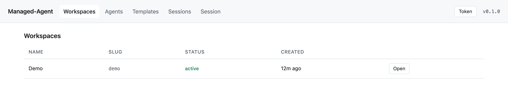

点 **Open** 进入该工作区的 Agent 列表。

### 5.2 Agents 与配额

Agent 是一份有名字、有版本的配置（提示词、模型、工具策略、沙箱规格）。Agents 页顶部是工作区的实时配额卡片，下面是每个 Agent 的最新版本、生产版本和状态。

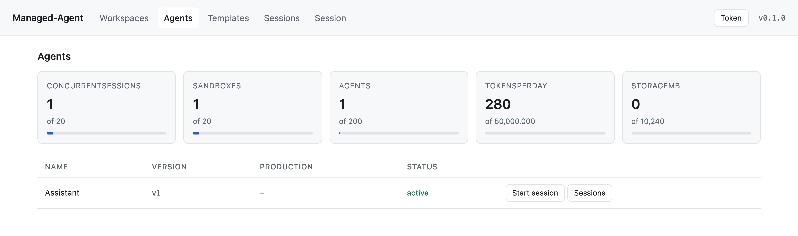

- **配额卡片**：每张显示「已用 of 上限」和一个进度条：
  - **ConcurrentSessions** 和 **Sandboxes**：此刻占着沙箱的会话数。
  - **Agents**：工作区里的 Agent 数。
  - **TokensPerDay**：今天用掉的模型 token。
  - **CostPerDay**：今天的模型调用花了多少钱，单位是**微美元**（31,390 约合 $0.03）。上限为 **0 表示不封顶**；设一个值就能在达到时停止花费。
  - **StorageMb**：产物占用的存储，包括上传的文件。
  - **KnowledgeChunks**：工作区所有数据集里已索引的分块数。
- **Version / Production**：*Sales analyst* 有两个版本，生产版本钉在 v2，所以新会话跑 v2。没有钉生产版本（显示 –）的 Agent 跑最新版本。
- **Start session**：分配一个沙箱，并打开新会话的详情页。
- **Sessions**：只列出这个 Agent 的会话。

### 5.3 模板（Templates）

模板是带参数的 Agent 蓝图。平台内置四个，每个工作区还可以添加自己的。每行显示分类、是内置还是工作区自定义，以及它需要的变量。

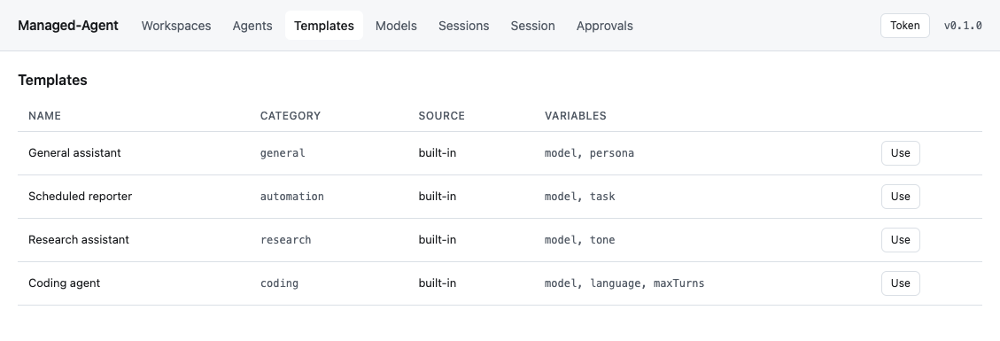

点 **Use** 用模板创建一个新 Agent，控制台会逐个询问模板声明的变量。上面的 *Helpdesk assistant* 就是用 **General assistant** 填上 `model` 和 `persona` 创建的。

### 5.4 模型（Models）

Models 页是平台的模型目录：Agent 可以调用哪些模型，每个都标着 **free** 或 **paid**，并显示上下文窗口大小和能否调用工具。所有提供方的密钥都由平台持有，调用也由平台发出；免费模型不花钱。

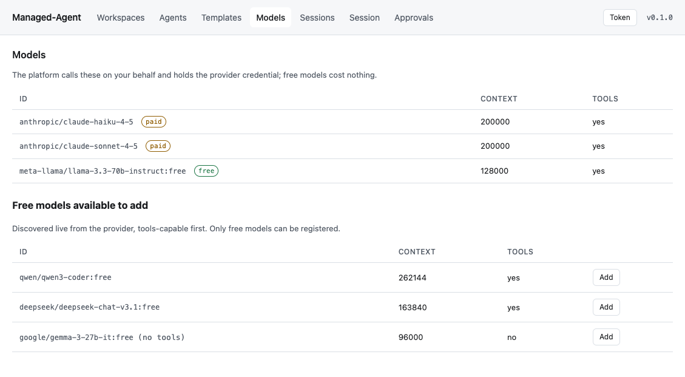

- **目录**（上半部分）：这里有 Anthropic 提供方的两个 Claude 模型，以及 OpenRouter 的一个免费 Llama 模型。工作区只看得到它被允许使用的模型。
- **Free models available to add**（下半部分）：OpenRouter 此刻提供的免费模型，实时拉取，能调用工具的排在前面。只有列出的每一项价格都是 0，才算免费。**Add** 把它登记进目录，需要平台管理员。不能调用工具的模型（*no tools*）能聊天，但跑不了 Agent 的工具。

### 5.5 会话列表（Sessions）

会话就是与一个 Agent 的一段对话。Sessions 页列出每个会话的状态、实际使用的版本、回合数、token 用量和最近活动时间。

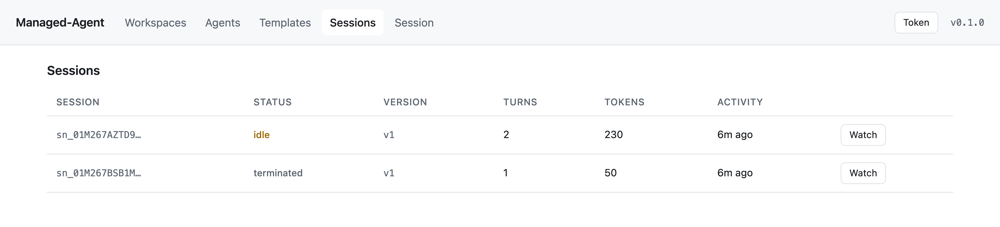

两个 0 回合的 `running` 会话属于 *Release manager*：它们都停在第一个回合里，等人批准一次工具调用（见[审批一次工具调用](#511-审批一次工具调用)）。点 **Watch** 打开会话。

### 5.6 进行中的会话

Session 页是值班的人真正待着的地方。它显示会话的身份和累计数据、实时控制按钮、消息输入框、日志搜索，以及完整的事件日志。事件日志通过 server-sent events 实时更新。

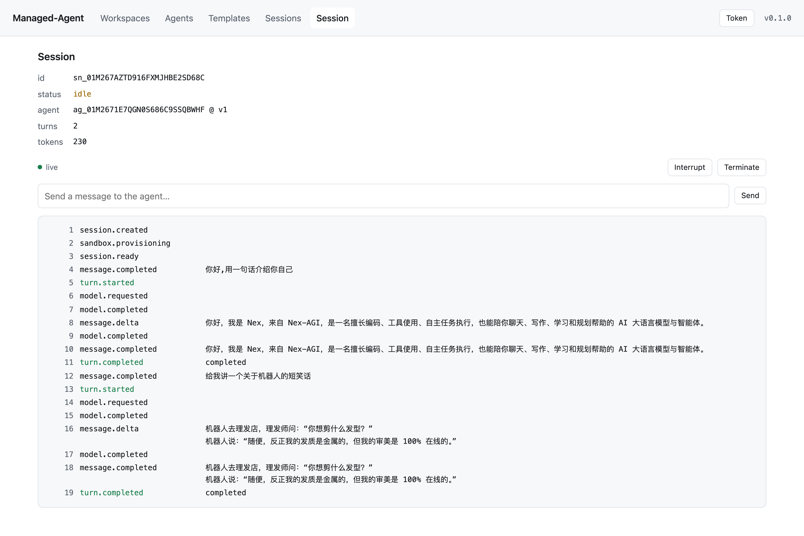

- **头部**：`id`、`status`（这里是 `idle`：一个回合已结束，等下一条消息）、实际使用的 `agent @ version`、`turns` 和 `tokens`。每个回合结束时都会更新。
- **model**：这个会话调用的模型，标着 free 或 paid，后面是版本声明的备用模型（fallbacks），以及 **Change** 按钮（见[只为这个会话换模型](#59-只为这个会话换模型)）。
- **`live` 指示**：事件流连着时是绿色。
- **Interrupt**：停下当前回合。
- **Terminate**：结束会话并释放沙箱（不可撤销，控制台会先确认）。
- **输入框**：输入消息后点 **Send**。**Attach files** 可以随消息附带文件（见[给 Agent 文件](#57-给-agent-文件)）。
- **事件日志**：所有事件按顺序排列：先是 `session.created → sandbox.provisioning → session.ready`，然后每个回合是 `turn.started → model.requested → message.delta → model.completed → message.completed → turn.completed`；Agent 用工具时会出现 `tool.*` 行。每条 `model.completed` 显示模型、耗时和产出的 token 数；发生故障转移时，会写明是从哪个模型切过来的。

第 12 行是一条带附件发出的消息（`attached: sales.csv (192 B)`）；第 18–23 行是 Agent 用 `read_file` 读取它。

### 5.7 给 Agent 文件

**Send** 旁边的 **Attach files** 可以为下一条消息挑最多 10 个文件。输入框下方会列出它们，每个都带 **Remove**：

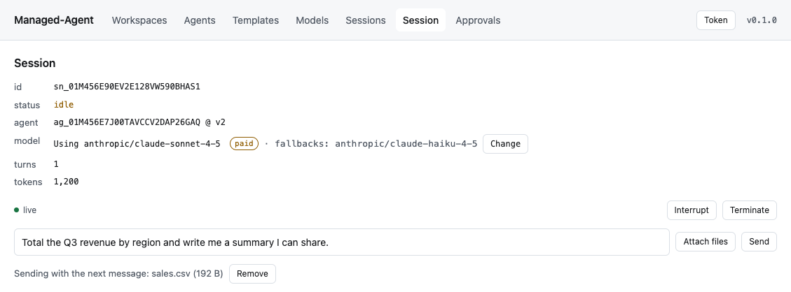

发送时，控制台把每个文件上传到会话，再附到这条消息上。回合开始前，沙箱工作目录里已经有 `attachments/sales.csv`，提示词也会告诉 Agent 文件在哪。这条消息的日志行会列出它带了哪些文件。

- 每个文件最大 `MA_ARTIFACT_MAX_MB`（默认 25 MB），并计入工作区的存储配额。
- 文本文件 Agent 可以直接读。PDF 或其他二进制格式需要能理解它的工具：沙箱里有的命令行工具，或者一个 skill。
- 会话会保留它的文件：之后为它重建的沙箱（换模型或恢复之后）会按原名拿回这些文件。

### 5.8 拿回 Agent 产出的文件

平台会告诉 Agent：要交给你的文件放进 `outputs/`。回合结束时那里有什么，就把什么存成这个会话的产物，而且是在回合被报告结束*之前*存好；日志里会出现一行 `artifact.created`，带 **Download** 按钮：

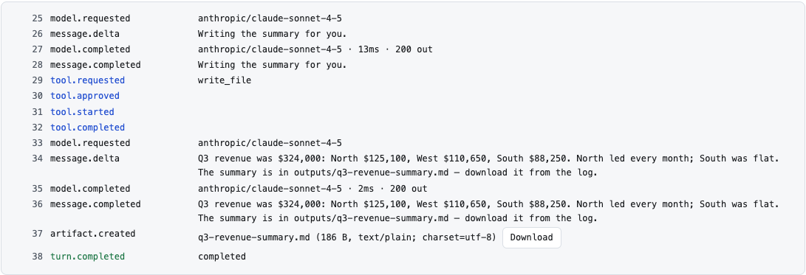

这里 Agent 用 `write_file` 写了 `outputs/q3-revenue-summary.md`（第 29–32 行），第 37 行就是存下来的文件：名称、大小、内容类型和 **Download**。文件只在内容变化时才会重新保存；隐藏文件（名字以点开头）和链接不保存；每个回合最多保存 50 个文件。

存不下的文件不会悄无声息地丢掉，而是一行红色的 `artifact.failed`，写明原因：

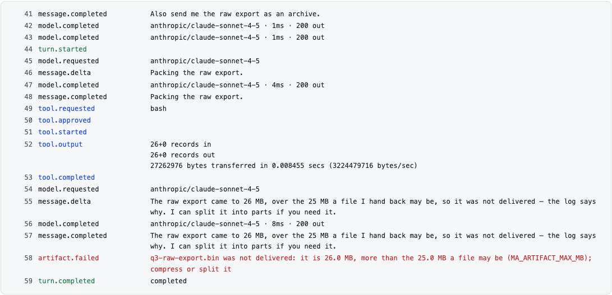

Agent 生成了一个 26 MB 的文件，超过了 25 MB 的上限，所以第 58 行说明它没有交付，以及该怎么办（压缩或拆分）。超出工作区存储配额的文件也会这样报告。

### 5.9 只为这个会话换模型

会话用的是它的 Agent 版本指定的模型。模型那一行的 **Change** 可以**只为这个会话**换成目录里的另一个模型，Agent 本身和它的其他会话都不受影响：

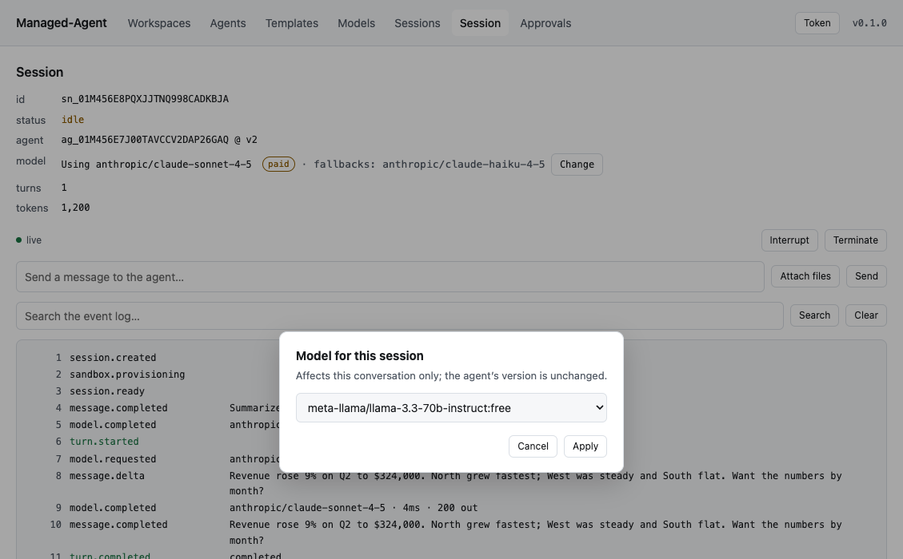

列表里是版本默认的模型，以及工作区可以使用的所有模型。**Apply** 立即在运行中的沙箱上生效，下一回合就用新模型：

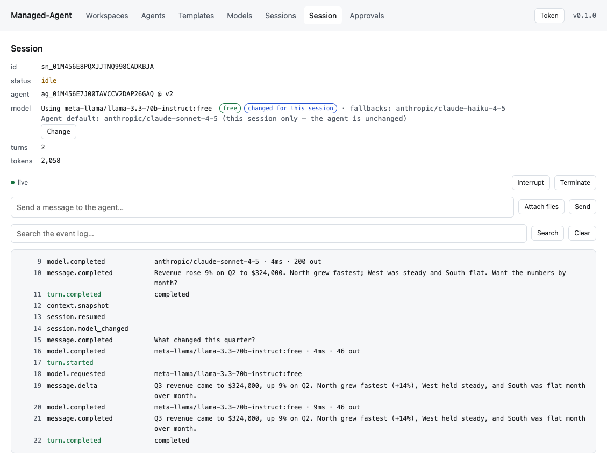

模型那一行现在显示 **changed for this session**，下面一行是 Agent 的默认模型。日志记下了 `session.model_changed`（第 14 行），随后那个回合的 `model.requested` 和 `model.completed` 都是新模型。选 *Version default* 可以换回去。

- 换模型需要 developer 角色。它改变的是一次运行的花费，所以门槛和在版本上设置模型相同。
- 回合进行中会被拒绝，返回 `409 CONFLICT`；请在回合之间换。
- 如果选中的模型后来被移出目录，或不再在工作区的允许列表里，会话会退回版本的模型，而不会继续调用它。

### 5.10 搜索日志

日志上方的搜索框在会话的全部历史里查找，不只是屏幕上显示的部分。它不区分大小写，匹配事件数据里任何位置的文本，所以命中的内容可能在日志行没有显示的字段里（这里第 16 和 24 行命中的是工具调用的结果）：

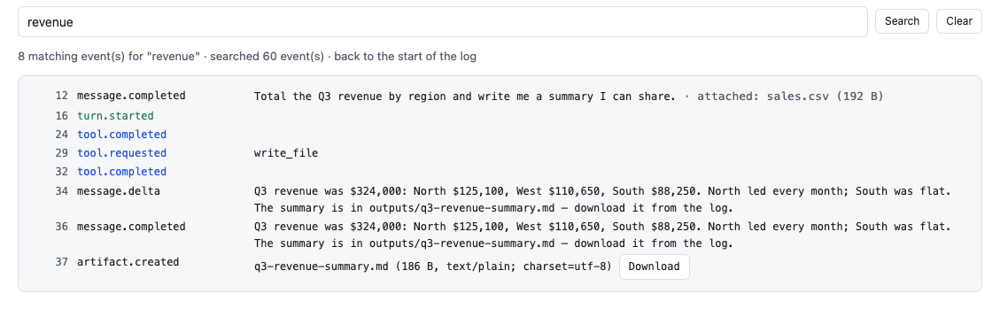

状态行会说明命中了多少条、搜到了多早；日志很长时会出现 **Search older**，可以接着往前搜。显示搜索结果时实时事件流会暂停，**Clear** 回到实时日志。

### 5.11 审批一次工具调用

工具策略为 `prompt` 的 Agent，要执行策略里没有放行的工具时会先问人。等待期间，会话在日志上方的 **Waiting for you** 下面显示这次调用：

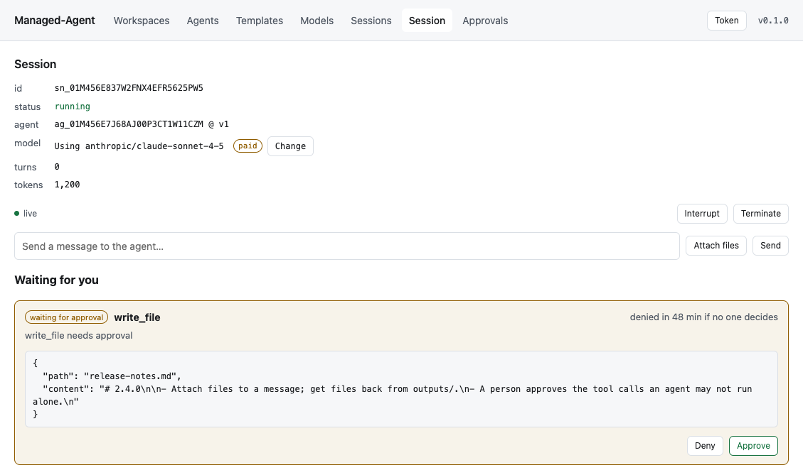

卡片上有工具名（`write_file`）、它将使用的完整参数、策略给出的理由，以及还剩多久没人处理就会被拒绝（这个 Agent 最多等一小时，即 `tools.approvalTimeoutSeconds: 3600`；默认是 10 分钟）。会话保持 `running`，回合处于暂停状态。

- **Approve**：执行这次调用，回合继续。
- **Deny**：会问你理由；Agent 把这段理由当作调用结果读到，可以改走别的路。

卡片的出现和消失都是实时的，包括别人在另一个控制台、CLI 或 API 上做了决定的时候。日志会记下请求和决定，以及是谁做的决定：

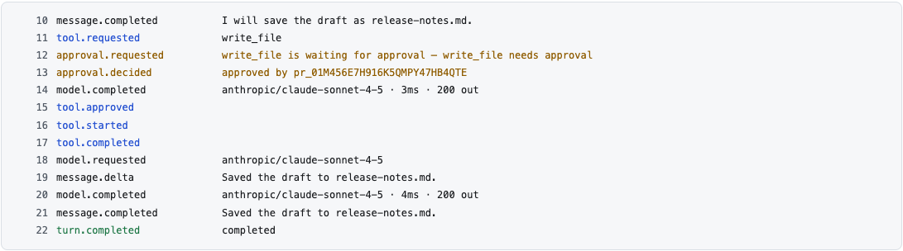

第 12 行是请求，第 13 行是决定（`approved by pr_…`），第 15–17 行是工具真正执行。做决定需要 operator 或更高的角色。

### 5.12 审批队列（Approvals）

**Approvals** 页汇集了整个工作区里所有等人处理的调用，不用一个个打开会话去找：

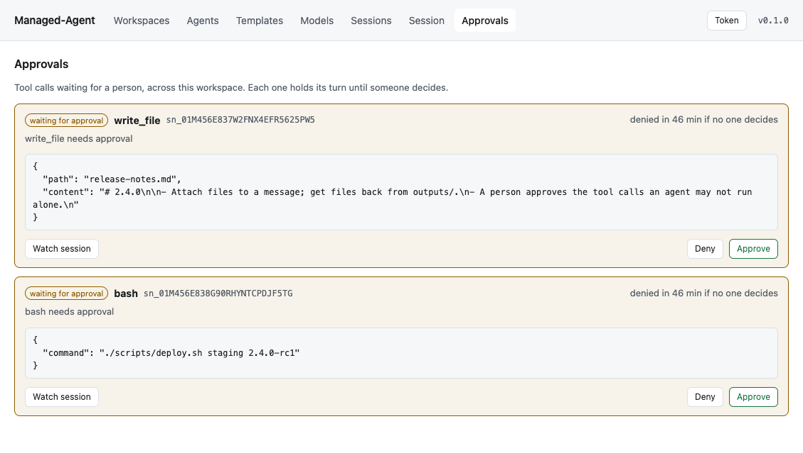

每张卡片写明所属会话，有和会话页一样的 **Approve** 和 **Deny**，还有 **Watch session** 可以打开它所在的对话。viewer 能看到队列，但不能做决定。

### 5.13 已结束的会话

会话被终止（或失败）之后以**只读**方式显示：指示显示 `ended`，控制按钮和输入框都不见了，事件日志保留以供审计，仍然可以搜索。

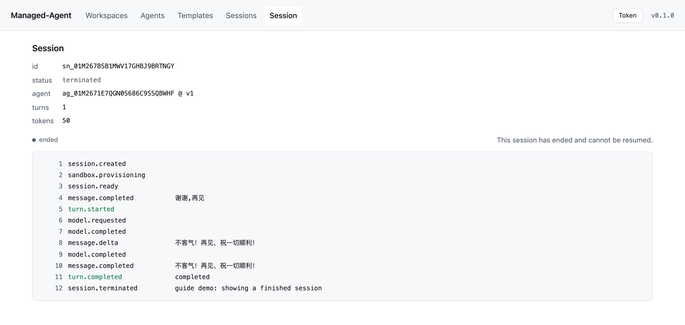

日志以 `session.terminated` 及其原因（`check-in done`）结尾，头部保留最终的 `turns` 和 `tokens`。已结束的会话不能恢复，请新开一个。

---

## 6. 实操演练

演练里用到下面这些变量；怎么查到这些 ID，见 [HTTP API](#7-使用-http-api) 一节。

```bash
export MA_URL=http://127.0.0.1:8080        # ma CLI 读取
export MA_TOKEN=demo-admin-token
export MA=$MA_URL TOK=$MA_TOKEN             # curl 示例使用
export WS=ws_...                            # 你的工作区
export AGENT=ag_...                         # 你的 Agent
```

会修改东西的 `ma` 命令只打印计划、什么都不改，直到你加上 `--yes`。

### 6.1 第一次对话

1. **打开工作区。** Workspaces → 在 *Demo* 上点 **Open**。
2. **开一个会话。** Agents → 在 *Assistant* 上点 **Start session**。控制台会打开新会话，可以看到它经历 `queued → provisioning → ready`（本地沙箱几秒就起来）。
3. **发一条消息。** 在输入框里输入后点 **Send**。你会实时看到 `turn.started`、`model.requested`、`message.delta`（流式输出）、`model.completed`、`message.completed`、`turn.completed`，头部的 `turns` 和 `tokens` 也随之增加。
4. **继续聊。** 每条消息都是同一个会话里的新回合。
5. **需要时介入。** **Interrupt** 停下失控的回合；**Terminate** 结束会话并释放沙箱。

这一个流程就走通了整条链路：分配沙箱 → agent-core → 控制面的模型网关 → 上游模型 → 事件日志。

### 6.2 让 Agent 处理文件

1. **允许 Agent 使用文件工具。** 发布一个在工具策略里放行它们的版本。发布的 spec 会合并到上一个版本上，所以文件里只写要改的部分：

   ```bash
   cat > tools.json <<'EOF'
   { "tools": { "mode": "strict", "allow": ["read_file", "write_file", "list_directory"] } }
   EOF
   ma agent version create --agent $AGENT --spec tools.json --summary "Let it read and write files" --yes
   ```

   此后新开的会话都跑新版本（如果 Agent 钉了生产版本，用 `ma agent update --agent $AGENT --production-version N --yes` 把它移到新版本）。正在运行的会话继续用它开始时的版本。
2. **开一个会话**，在输入框旁点 **Attach files**，选 `sales.csv`。
3. **让它把结果写成文件**，例如：*「按地区汇总 Q3 营收，写一份我能分享出去的总结。」* Agent 会读 `attachments/sales.csv`，写 `outputs/…`，然后回答。
4. **下载。** `artifact.created` 那一行有 **Download**（见[拿回 Agent 产出的文件](#58-拿回-agent-产出的文件)）。也可以用命令行：

   ```bash
   ma artifact list --workspace $WS --session sn_...
   ma artifact get --artifact ar_... --out q3-revenue-summary.md
   ```

整个过程也可以全用 CLI，附件一并带上：

```bash
ma session create --agent $AGENT --title "Q3 sales review" --yes
echo "Total the Q3 revenue by region and write me a summary I can share." > ask.txt
ma session send --session sn_... --prompt-file ask.txt --attach sales.csv --yes
ma session watch --session sn_... --types turn.,artifact.
```

### 6.3 先问人再动手的 Agent

1. **把 Agent 切到 `prompt` 模式。** 已放行的工具照常直接执行，其余的都要等人决定：

   ```bash
   cat > ask-first.json <<'EOF'
   { "tools": { "mode": "prompt", "allow": ["read_file", "list_directory"], "approvalTimeoutSeconds": 3600 } }
   EOF
   ma agent version create --agent $AGENT --spec ask-first.json --summary "Ask before writing or running commands" --yes
   ```

2. **开一个会话，让它做一件要写文件的事**，例如：*「起草 2.4 的发布说明并保存。」* 回合会暂停，会话显示 **Waiting for you**（见[审批一次工具调用](#511-审批一次工具调用)）。
3. **做决定**：在会话页、**Approvals** 页，或者用 CLI：

   ```bash
   ma approval list --workspace $WS --status pending
   ma approval show --session sn_... --approval ap_...
   ma approval approve --session sn_... --approval ap_... --yes
   ma approval deny --session sn_... --approval ap_... --reason "not on production" --yes
   ```

需要知道的几点：

- 由连接器或定时任务启动的会话没有人可问，需要审批的调用会被立即拒绝。无人值守的 Agent 请用 `strict` 策略，并写明允许列表。
- 在 `approvalTimeoutSeconds` 内没人处理的调用会以过期为由被拒绝；回合本身的时限（`turnTimeoutSeconds`，默认 30 分钟）同样有效。
- 控制面重启、浏览器断线，等待都不会丢。

### 6.4 定时运行 Agent

定时任务是一个类型为 `schedule` 的连接器：按 cron 向 Agent 提交一段提示词。

```bash
cat > schedule.json <<'EOF'
{
  "cron": "0 8 * * 1-5",
  "timezone": "Europe/Berlin",
  "prompt": "Summarise yesterday's sales and flag any region that dropped more than 10%.",
  "skipIfRunning": true
}
EOF
ma connector create --workspace $WS --type schedule --name "Morning sales digest" \
  --external-key morning-digest --agent $AGENT --config schedule.json --yes
ma connector activate --connector cn_... --yes      # 需要 admin 角色
ma connector next-fire --connector cn_...           # 下一次什么时候跑
ma connector run --connector cn_... --yes           # 立刻跑一次，试一试
ma connector receipts --connector cn_...            # 每次触发一张回执
```

- `cron` 是五段式表达式，按 `timezone`（默认 `UTC`）计算，夏令时切换前后都正确。
- `skipIfRunning`（默认 `true`）：上一次还没跑完时跳过这次触发。
- `misfireGraceSeconds`（默认 300）：比预定时间晚了这么久的触发（比如服务端停机之后）直接跳过，而不是迟到再跑。
- 连接器创建后是 `draft` 状态，激活之前不接收任何东西。

默认每次触发都开一个新会话；要复用会话，见[会话策略](#109-连接器connectors)。定时任务没有触发时，见 [Operations → A schedule that did not fire](operations.md#a-schedule-that-did-not-fire)。

### 6.5 用 webhook 触发 Agent

webhook 连接器把一个带签名的 HTTP 请求变成发给 Agent 的一条消息。

1. **把签名密钥存成凭据**（任意类型都行，凭据的值就是密钥）：

   ```bash
   openssl rand -hex 32 > webhook-secret.txt
   ma credential create --workspace $WS --name support-webhook --type api_key \
     --value-file webhook-secret.txt --yes
   ```

2. **创建并激活连接器：**

   ```bash
   ma connector create --workspace $WS --type webhook --name "Support tickets" \
     --external-key support-tickets --agent $AGENT \
     --session-policy reuse_per_scope --secret-credential cr_... --yes
   ma connector activate --connector cn_... --yes
   ```

3. **向 `/ingress/v1/{workspaceId}/{externalKey}` 发一个签名请求。** 签名是用密钥对 `{timestamp}.{原始请求体}` 计算的 HMAC-SHA256（十六进制）；时间戳是 Unix 纪元**毫秒**，与服务端时钟相差不能超过 5 分钟：

   ```bash
   BODY='{"prompt":"Summarise ticket #4821 and suggest a reply.","eventId":"ticket-4821","scope":"ticket-4821"}'
   TS=$(( $(date +%s) * 1000 ))
   SIG=$(printf '%s.%s' "$TS" "$BODY" | openssl dgst -sha256 -hmac "$(cat webhook-secret.txt)" -hex | sed 's/^.* //')
   curl -s -X POST -H 'content-type: application/json' \
     -H "x-ma-timestamp: $TS" -H "x-ma-signature: $SIG" \
     --data "$BODY" "$MA/ingress/v1/$WS/support-tickets"
   # {"status":"accepted","receiptId":"rc_..."}   (202)
   ```

请求体里的 `prompt` 就是消息内容（没有 `prompt` 时，整个 JSON 请求体会作为消息发出）。`eventId` 让重试变得安全：同一个 id 再次送达时，会以 duplicate（200）报告并返回原来那张回执，而不会再跑一次。使用 `reuse_per_scope` 时，`scope` 相同的请求都会续在同一个会话里，这里就是每张工单一段对话。签名错误或时间戳过期会被拒绝，返回 `401 DELIVERY_REJECTED`。

Slack、飞书、SQS、Kafka 的接法相同，只是各有各的配置，见 [Operations → Connecting Slack or Feishu](operations.md#connecting-slack-or-feishu) 和 [Connecting a queue or a topic](operations.md#connecting-a-queue-or-a-topic-sqs-kafka)。

### 6.6 给 Agent 配知识库

```bash
ma dataset create --workspace $WS --name "Pricing policies" --yes
ma dataset add-document --dataset ds_... --name discounts.md --content-file discounts.md \
  --content-type text/markdown --yes
ma dataset documents --dataset ds_...                # 等文档索引完成
ma dataset bind --agent $AGENT --datasets ds_... --yes
```

绑定会发布一个列出该数据集的新 Agent 版本（Agent 必须已经有版本；如果钉了生产版本，要把它移到新版本）。跑在这个版本上的会话会多一个 `search_knowledge` 工具，只搜索绑定到该版本的数据集；如果策略是 `strict`，要在工具策略里放行它。检索基于关键词（BM25），不是语义检索。

---

## 7. 使用 HTTP API

API 位于 `/v1` 下，每个请求都要带 bearer token。完整的生成式规范在 `GET /openapi.json`。

```bash
export MA=http://127.0.0.1:8080
export TOK=demo-admin-token
```

### 查找工作区及其 Agent

```bash
curl -s -H "authorization: Bearer $TOK" "$MA/v1/workspaces"
curl -s -H "authorization: Bearer $TOK" "$MA/v1/workspaces/$WS/agents"
```

### 开会话、发消息、读日志

```bash
# 创建会话
SID=$(curl -s -X POST -H "authorization: Bearer $TOK" -H 'content-type: application/json' \
  -d "{\"agentId\":\"$AGENT\"}" "$MA/v1/sessions" | jq -r .session.id)

# 等几秒到 'ready'，再发消息
curl -s -X POST -H "authorization: Bearer $TOK" -H 'content-type: application/json' \
  -d '{"events":[{"type":"user.message","text":"Hello!"}]}' \
  "$MA/v1/sessions/$SID/events"

# 读事件日志（加 &q=revenue 可搜索，加 &types=tool.,turn. 可过滤）
curl -s -H "authorization: Bearer $TOK" "$MA/v1/sessions/$SID/events?limit=100"
```

### 给 Agent 一个文件

先把文件上传到会话：请求体就是文件本身，文件名放在查询参数里。然后在消息的 `attachments` 里写上返回的产物 ID：

```bash
FILE=$(curl -s -X POST -H "authorization: Bearer $TOK" -H 'content-type: application/octet-stream' \
  --data-binary @sales.csv "$MA/v1/sessions/$SID/files?name=sales.csv" | jq -r .artifact.id)

curl -s -X POST -H "authorization: Bearer $TOK" -H 'content-type: application/json' \
  -d "{\"events\":[{\"type\":\"user.message\",\"text\":\"Total the sales by region.\",\"attachments\":[\"$FILE\"]}]}" \
  "$MA/v1/sessions/$SID/events"
```

回合开始前，沙箱里已经有 `attachments/sales.csv`。同一个会话里两个同名文件会被编号，如 `sales (2).csv`。

- 上传的文件是会话的一个产物，计入工作区存储，上限 `MA_ARTIFACT_MAX_MB`。同名且内容相同的文件只存一份。
- 上传需要 `session.send` 权限。附加文件还需要对该文件有 `artifact.download` 权限，因为附加就是把内容交给 Agent，也就交给了所有能读这个会话的人。
- 一条消息可以附加本工作区里任何可用的产物，包括之前别的会话产出的；不能附加其他工作区的；每次提交最多 10 个。

### 拿回文件

```bash
curl -s -H "authorization: Bearer $TOK" "$MA/v1/workspaces/$WS/artifacts?sessionId=$SID"
curl -s -H "authorization: Bearer $TOK" -o report.md "$MA/v1/artifacts/$ARTIFACT/content"
```

每个存下来的文件都是会话日志里的一条 `artifact.created` 事件，带有它的 `artifactId`；看到 `turn.completed` 时，这一回合的文件已经存好了。这是内置运行时的约定；command 运行时要自己用 `POST /runtime/v1/artifacts` 保存文件（见[运行时协议](runtime-protocol.md)）。

### 批准或拒绝一次工具调用

```bash
curl -s -H "authorization: Bearer $TOK" "$MA/v1/workspaces/$WS/approvals?statuses=pending"

curl -s -X POST -H "authorization: Bearer $TOK" -H 'content-type: application/json' \
  -d '{"decision":"deny","reason":"use the staging cluster"}' \
  "$MA/v1/sessions/$SID/approvals/$APPROVAL/decision"
```

对已经了结（已决定、已过期或已取消）的审批再做决定，返回 `409`。

### 换会话的模型

```bash
curl -s -X PUT -H "authorization: Bearer $TOK" -H 'content-type: application/json' \
  -d '{"modelId":"meta-llama/llama-3.3-70b-instruct:free"}' "$MA/v1/sessions/$SID/model"
# 传 {"modelId": null} 换回版本的模型
```

### 实时事件流（SSE）

```bash
curl -N -H "authorization: Bearer $TOK" -H 'accept: text/event-stream' \
  "$MA/v1/sessions/$SID/events/stream?fromSeq=0"
```

每一帧的 `id` 就是事件序号，所以客户端重连时（浏览器的 `EventSource` 会自动重连）能无缝续上，既不漏也不重复。

### 中断、终止、续期

```bash
curl -s -X POST -H "authorization: Bearer $TOK" -H 'content-type: application/json' \
  -d '{"reason":"stop"}' "$MA/v1/sessions/$SID/interrupt"

curl -s -X POST -H "authorization: Bearer $TOK" -H 'content-type: application/json' \
  -d '{"reason":"done"}' "$MA/v1/sessions/$SID/terminate"
```

### 连接器与数据集

```bash
# 一个 webhook 连接器（创建后是 draft），然后激活
curl -s -X POST -H "authorization: Bearer $TOK" -H 'content-type: application/json' \
  -d "{\"type\":\"webhook\",\"name\":\"Support tickets\",\"externalKey\":\"support-tickets\",\"agentId\":\"$AGENT\",\"sessionPolicy\":\"reuse_per_scope\",\"secretCredentialId\":\"$CRED\",\"config\":{}}" \
  "$MA/v1/workspaces/$WS/connectors"
curl -s -X POST -H "authorization: Bearer $TOK" -H 'content-type: application/json' \
  -d '{"status":"active"}' "$MA/v1/connectors/$CONNECTOR/status"

# 一个只有一篇文档的数据集，绑定到 Agent
curl -s -X POST -H "authorization: Bearer $TOK" -H 'content-type: application/json' \
  -d '{"name":"Pricing policies"}' "$MA/v1/workspaces/$WS/datasets"
curl -s -X POST -H "authorization: Bearer $TOK" -H 'content-type: application/json' \
  -d '{"name":"discounts.md","contentType":"text/markdown","content":"Volume discounts start at 50 seats."}' \
  "$MA/v1/datasets/$DATASET/documents"
curl -s -X PUT -H "authorization: Bearer $TOK" -H 'content-type: application/json' \
  -d "{\"datasetIds\":[\"$DATASET\"]}" "$MA/v1/agents/$AGENT/datasets"
```

### 常用端点

| 方法与路径 | 用途 |
|---|---|
| `GET /health` | 存活检查（`{"status":"ok","version":"..."}`） |
| `GET /openapi.json` | API 的 OpenAPI 文档 |
| `GET /v1/workspaces` · `POST /v1/workspaces` | 列出 / 创建工作区 |
| `PUT /v1/workspaces/:id/members` | 设置成员及角色（把 ETag 作为 `If-Match` 发送，避免覆盖别人同时做的修改） |
| `GET /v1/workspaces/:id/grants` · `POST` · `DELETE …/:grantId` | 单资源授权 |
| `GET /v1/workspaces/:id/quota` | 配额上限与用量 |
| `GET /v1/workspaces/:id/usage` | 每日用量与成本历史 |
| `GET /v1/workspaces/:id/agents` · `POST` | 列出 / 创建 Agent |
| `POST /v1/agents/:id/versions` | 发布 Agent 新版本（默认合并到上一版本，`replace` 时整体替换） |
| `POST /v1/agents/:id/archive` | 归档 Agent |
| `GET /v1/workspaces/:id/templates` | 列出模板 |
| `POST /v1/workspaces/:id/templates/:tid/instantiate` | 用模板创建 Agent |
| `POST /v1/sessions` · `GET /v1/sessions` | 开会话 / 列出会话（`?workspaceId=` 或 `?agentId=`） |
| `GET /v1/sessions/:id` | 会话详情 |
| `POST /v1/sessions/:id/events` | 提交用户事件 |
| `POST /v1/sessions/:id/files?name=` | 为 Agent 上传文件（请求体为原始内容）；把返回的产物 ID 附到消息上 |
| `GET /v1/sessions/:id/events` | 读事件日志（`fromSeq`、`toSeq`、`types`、`order`，`q` 用于搜索） |
| `GET /v1/sessions/:id/events/stream` | 实时 SSE 流 |
| `POST /v1/sessions/:id/interrupt` · `terminate` · `renew` | 停下回合 / 结束会话 / 延长租期 |
| `PUT /v1/sessions/:id/model` | 只为这个会话改用目录里的另一个模型（`{"modelId": null}` 清除）；回合进行中返回 409 |
| `GET /v1/sessions/:id/approvals` | 这个会话里等过人决定的工具调用（`?statuses=pending` 只看还在等的） |
| `POST /v1/sessions/:id/approvals/:aid/decision` | 批准或拒绝一次等待中的调用（`{"decision":"approve"\|"deny","reason":"…"}`）；已了结时返回 409 |
| `GET /v1/workspaces/:id/approvals` | 工作区的审批队列（`?statuses=pending`） |
| `GET /v1/workspaces/:id/artifacts` | Agent 产出的文件以及为它上传的文件（`?sessionId=`） |
| `GET /v1/artifacts/:id/content` | 下载产物 |
| `GET /v1/workspaces/:id/credentials` · `POST` | 列出凭据（只有元数据）/ 创建凭据（值只写不读） |
| `GET /v1/workspaces/:id/connectors` · `POST` | 列出 / 创建连接器 |
| `POST /v1/connectors/:id/status` · `run` | 激活、停用或归档 / 立即触发一次定时任务 |
| `GET /v1/connectors/:id/receipts` · `POST /v1/receipts/:id/retry` | 投递回执 / 重放一张回执 |
| `POST /ingress/v1/:workspaceId/:externalKey` | webhook 或机器人连接器的入站投递 |
| `GET /v1/workspaces/:id/datasets` · `POST` | 列出 / 创建数据集 |
| `POST /v1/datasets/:id/documents` | 添加文档 |
| `PUT /v1/agents/:id/datasets` | 把数据集绑定到 Agent |
| `GET /v1/workspaces/:id/memories` | 列出记忆 |
| `POST /v1/memories/:id/promote` | 允许一条记忆进入系统提示词，或撤回 |
| `GET /v1/workspaces/:id/audit` · `GET /v1/audit/verify` | 审计日志 / 校验哈希链 |
| `GET /v1/models` | 调用者可用的模型 |
| `GET /v1/models/free` | 已配置的提供方当前提供的免费模型，能调用工具的在前 |
| `POST /v1/models/free` | 把其中一个登记进目录（平台管理员，需 `model.register` scope） |

---

## 8. 使用 TypeScript SDK

`@ma/sdk`（位于 `packages/sdk`）是一个带类型的客户端，浏览器和 Node 都能用。可以安全重试的请求它会自动重试；事件流断线后会自己续上。

```ts
import { readFile } from 'node:fs/promises';
import { ManagedAgentClient } from '@ma/sdk';

const client = new ManagedAgentClient({ baseUrl: 'http://127.0.0.1:8080', token: process.env.MA_TOKEN! });

const { session } = await client.createSession({ agentId: 'ag_...', title: 'Q3 sales review' });

// 交给 Agent 一个文件，并要一个结果。
const { artifact } = await client.uploadFile(session.id, 'sales.csv', new Uint8Array(await readFile('sales.csv')));
await client.prompt(session.id, 'Total the Q3 revenue by region and write me a summary.', {
  attachments: [artifact.id],
});

// 跟着这个回合走：批准它请求的调用，收下它交回的文件。
for await (const event of client.streamEvents(session.id)) {
  if (event.type === 'approval.requested') {
    const { approvalId } = event.payload as { approvalId: string };
    await client.approve(session.id, approvalId, 'reviewed by the release bot');
  }
  if (event.type === 'artifact.created') {
    const { artifactId, path } = event.payload as { artifactId: string; path: string };
    console.log(path, (await client.downloadArtifact(artifactId)).byteLength, 'bytes');
  }
  if (event.type === 'turn.completed') break;
}
```

本手册涉及的每类资源，客户端都有对应的方法，例如 `setSessionModel`、`listWorkspaceApprovals`、`deny`、`createConnector`、`activateConnector`、`runConnector`、`createDataset`、`addDocument`、`bindDatasets`、`createMemory`、`instantiateTemplate`、`listFreeModels` 和 `listAudit`。会话进入终态，或你传入的 `signal` 中止时，`streamEvents` 会自行结束。

---

## 9. 使用 `ma` CLI

CLI 封装的是同一套 API。通过环境变量告诉它服务地址和 token：

```bash
export MA_URL=http://127.0.0.1:8080
export MA_TOKEN=demo-admin-token          # 或者用 --token-file FILE
```

优先用 `MA_TOKEN` 或 `--token-file`：写在命令行上的 `--token` 其他进程能看到。机密内容（凭据的值、提示词）都从文件读取，从不作为参数传入。

**所有会修改东西的命令都只打印计划、什么都不改，除非加上 `--yes`。** 读取类命令加 `--json` 输出机器可读的结果。`ma --help` 列出全部命令。

```bash
# 工作区
ma workspace list
ma workspace create --name "My Team" --slug my-team --yes
ma workspace quota --workspace ws_...

# Agent 与版本
ma agent list --workspace ws_...
ma agent create --workspace ws_... --name Assistant --spec spec.json --yes
ma agent version create --agent ag_... --spec patch.json --summary "Allow file tools" --yes
ma agent version list --agent ag_...
ma agent update --agent ag_... --production-version 2 --yes

# 会话
ma session create --agent ag_... --title "Support chat" --yes
ma session send --session sn_... --prompt-file prompt.txt --attach sales.csv,notes.txt --yes
ma session watch --session sn_... --types turn.,message.,artifact.
ma session events --session sn_... --q revenue --order desc --limit 50
ma session model --session sn_... --model meta-llama/llama-3.3-70b-instruct:free --yes
ma session model --session sn_... --clear --yes
ma session renew --session sn_... --ttl 3600 --yes
ma session terminate --session sn_... --reason "done" --yes

# 审批
ma approval list --workspace ws_... --status pending
ma approval show --session sn_... --approval ap_...
ma approval approve --session sn_... --approval ap_... --yes
ma approval deny --session sn_... --approval ap_... --reason "not on production" --yes

# 文件
ma artifact list --workspace ws_... --session sn_...
ma artifact get --artifact ar_... --out report.md

# 模型
ma model list --workspace ws_...
ma model free                                   # 提供方当前的免费模型
ma model free-add --model qwen/qwen3-coder:free --yes

# 连接器与投递
ma connector create --workspace ws_... --type schedule --name Digest --external-key digest \
  --agent ag_... --config schedule.json --yes
ma connector activate --connector cn_... --yes
ma connector run --connector cn_... --yes
ma connector receipts --connector cn_... --statuses failed
ma receipt retry --receipt rc_... --reason "upstream was down" --yes

# 知识库
ma dataset create --workspace ws_... --name "Pricing policies" --yes
ma dataset add-document --dataset ds_... --name faq.md --content-file faq.md --yes
ma dataset bind --agent ag_... --datasets ds_... --yes

# 模板
ma template list --workspace ws_...
ma template instantiate --workspace ws_... --template at_... --name NewAgent --variables vars.json --yes

# 凭据（值从文件读取，之后再也看不到）
ma credential create --workspace ws_... --name OPENAI --type env_vars --value-file secret.json --yes
ma credential list --workspace ws_...

# 记忆
ma memory add --workspace ws_... --content "Deploys need a change ticket" --yes
ma memory list --workspace ws_... --injectable-only
ma memory promote --memory me_... --yes

# 审计
ma audit list --workspace ws_... --limit 50
```

---

## 10. 概念参考

### 10.1 会话生命周期

会话在一个小状态机里流转：

```
queued ─► provisioning ─► ready ─► running ─► idle
   │            │           │  ▲       │  │      │
   │            │           │  └───────┘  │      │  （每个回合 idle ⇄ running）
   │            │           └─────────────┴──────┴──► terminating ─► terminated
   └────────────┴──────────────────────────────────────────────────► failed
```

- **queued**：已接纳，等待沙箱（配额不够时就在这里排队，并且可见）。
- **provisioning**：正在获取沙箱。
- **ready**：已拿到沙箱，还没跑过回合。
- **running**：回合进行中（包括停下来等审批的回合）。
- **idle**：至少跑过一个回合，正在等下一个。
- **terminating**：正在关闭并释放沙箱。
- **terminated / failed**：终态。终态会话只读，不能中断、发消息或恢复。

丢了沙箱的会话（`sandbox.lost`）会在租期内拿到新沙箱，并从最近一次快照接着对话，而不是从头开始。

### 10.2 Agent 版本与 spec

Agent 有版本，且版本不可修改。会话**在创建时一次性确定版本**，之后不受任何修改影响：发布 v2 不会改变已经在跑的会话执行的内容；唯一的例外是，空闲的会话会在回合之间切到新的生产版本。Agent 可以**钉一个生产版本**（production pin）；新会话用钉住的版本，没钉就用最新版本。版本号 0 表示 Agent 还没有任何版本，不能运行。

一个版本的 spec 包含：

| 字段 | 作用 |
|---|---|
| `systemPrompt` | Agent 的指令 |
| `model` | `modelId`，以及可选的 `fallbackModelIds`（用于故障转移） |
| `tools` | 工具策略：`mode`、`allow`、`deny`、`allowedCommands`、`deniedCommands`、`approvalTimeoutSeconds`（见[下文](#103-工具策略与审批)） |
| `context` | 何时压缩对话、保留多少原文、多久做一次快照 |
| `sandbox` | 镜像、资源、网络策略、挂载、初始化命令 |
| `runtime` | `builtin`（默认）或 `command`：你自己的、遵循[运行时协议](runtime-protocol.md)的进程 |
| `skills`、`plugins`、`mcpServers`、`subAgents` | 额外能力（见[下文](#1012-skills插件mcp-服务器与子-agent)） |
| `credentialIds`、`datasetIds` | 沙箱获得的凭据；检索工具搜索的数据集 |
| `maxTurnsPerSession`、`turnTimeoutSeconds` | 限制：默认 200 个回合、每回合 30 分钟 |

发布时，你发送的 spec 会合并到上一个版本上，并返回改了哪些字段，所以没写的字段不会被悄悄丢掉；要写入一份完整的 spec，发送 `replace: true`（CLI 用 `--replace`）。

### 10.3 工具策略与审批

每次工具调用在执行前都要过一遍版本的工具策略：

| `mode` | 不在 `allow` 里的工具 |
|---|---|
| `strict`（默认） | 拒绝。无人值守的 Agent 就该用这个默认值 |
| `prompt` | 等人批准或拒绝 |
| `auto` | 执行，除非它在 `deny` 里 |
| `plan` | 只有只读工具才执行，会修改状态的一律不执行 |

- `deny` 在任何模式下都优先。
- shell 命令还要再过一道检查：`deniedCommands` 和 `allowedCommands` 按命令前缀匹配（`allowedCommands` 非空时，即使在 `auto` 模式下也会强制执行）。复合命令（`;`、`&&`、管道、命令替换）和会转手执行其他程序的包装命令（`sh -c`、`env`、`xargs`）直接拒绝，不去猜它们实际要做什么。
- 每次拒绝都会写明是哪条规则拒绝的，Agent 把它当作调用结果读到，于是可以换一条被允许的路。
- 内置工具有 `read_file`、`write_file`、`list_directory`、`search` 和 `bash`；skills、插件、MCP 服务器和数据集会再加上它们自己的工具。

**审批**（`prompt` 模式）：这次调用变成会话上的一条审批，在控制台显示，也能通过 API 和 CLI 列出。operator 或更高角色的人批准或拒绝；被拒绝时，Agent 会读到理由。由连接器或定时任务启动的会话会被立即拒绝（没有人可问）；在 `approvalTimeoutSeconds`（默认 600）内没人处理的调用以过期为由拒绝。请求、决定以及决定人都记在会话日志和审计记录里。详见 [Operations → Asking a person before a tool runs](operations.md#asking-a-person-before-a-tool-runs)。

### 10.4 文件的进与出

- **进：** 上传到会话并附在消息上的文件，在回合开始前就位于沙箱的 `attachments/<name>`，并经过摘要校验。沙箱只能读到附在它自己会话上的文件。重建的沙箱会拿回会话的文件。
- **出：** Agent 留在 `outputs/` 里的文件在回合结束时存成产物，每个都以一条 `artifact.created`（带 `artifactId`）公布；存不下的以 `artifact.failed` 写明原因。
- 两个方向都按单个文件 `MA_ARTIFACT_MAX_MB` 封顶，并计入工作区存储配额。产物按内容去重，超过 `MA_ARTIFACT_RETENTION_DAYS` 后会被清理。

### 10.5 事件日志

每个会话都有一份只追加、无空洞、带序号的事件日志。它既是审计记录，也是续传机制：客户端重连时，请求 `fromSeq = last_seen + 1` 之后的事件即可。主要事件类型：

- `session.created`、`sandbox.provisioning`、`session.ready`、`session.model_changed`
- `turn.started`、`turn.completed`、`turn.failed`
- `model.requested`、`model.completed`、`model.failed`
- `message.delta`（流式片段）、`message.completed`
- `tool.requested`、`tool.approved`、`tool.started`、`tool.output`、`tool.completed`
- `approval.requested`、`approval.decided`
- `artifact.created`、`artifact.failed`
- `context.snapshot`、`session.resumed`
- `session.interrupted`、`session.terminated`、`session.failed`、`sandbox.lost`
- `audit.permission.decided`、`audit.credential.accessed`

状态变化和对应的事件总是一起写入，所以回放日志总能还原出会话记录。

### 10.6 沙箱与复用

每个会话跑在一个沙箱里：本地驱动下是一个子进程，容器或 Kubernetes 驱动下是一个容器。沙箱为会话而创建，持有一个靠心跳续期的短租约，会话结束时释放（并销毁）。

跨会话**复用**沙箱只限于真正空闲、且配置完全一致的沙箱：镜像、资源、网络策略、挂载、初始化命令和凭据都要相同，所以热沙箱永远不会服务另一个 Agent，也不会带着已轮换的旧密钥。同一个 Agent 的并发会话各有各的沙箱。

### 10.7 模型、提供方与故障转移

- **一个目录。** 无论由哪个提供方提供，每个模型都是目录里的一个 ID，带有价格、上下文窗口和能否调用工具。网关拒绝不在目录里、或工作区无权使用的模型。
- **提供方。** OpenRouter、Anthropic、Azure OpenAI、AWS Bedrock 和 Google Vertex AI。每个提供方通过列出它的模型及价格来启用，例如 `MA_ANTHROPIC_MODELS='claude-sonnet-4-5@3/15/0.3/3.75'`（依次是输入 / 输出 / 缓存读 / 缓存写，单位为每百万 token 的美元价）。`MA_MODEL_WORKSPACES` 把模型保留给指定的工作区。见 [Operations → Native model providers](operations.md#native-model-providers)。
- **免费模型。** 配置了 OpenRouter 后，Models 页和 `ma model free` 会列出它此刻的免费模型；平台管理员点一下或用 `ma model free-add` 就能添加。OpenRouter 的付费模型需要显式开启（`MA_OPENROUTER_ALLOW_PAID`）。
- **容错。** 失败的调用会带退避重试；持续失败的模型会被熔断器摘掉；然后按顺序尝试版本里的 `fallbackModelIds`，可以跨厂商。用量记在真正给出回答的模型上，日志也会写明是哪一个。见 [Operations → When a model provider is flaky](operations.md#when-a-model-provider-is-flaky)。
- **按会话切换。** 可以只换一个会话的模型，不动它的 Agent（见[只为这个会话换模型](#59-只为这个会话换模型)）。

### 10.8 凭据

凭据只写不读：你提供值之后，就只能读到元数据。凭据有七种类型：`api_key`、`oauth_token`、`bearer_token`、`env_vars`、`file`、`ssh_key`、`basic_auth`。它们加密存储，可以属于工作区、Agent、会话或某个人，并可设置过期时间。版本里列出沙箱能拿到哪些凭据（`credentialIds`）；file 和 SSH key 类型的值写进只有属主能读的文件，从不出现在命令行里。连接器用凭据作为签名密钥。模型提供方的密钥不属于这类凭据：它们由平台持有，任何沙箱都看不到。

### 10.9 连接器（Connectors）

连接器从外部启动 Agent 的运行。类型如下：

| 类型 | 什么会启动一次运行 |
|---|---|
| `webhook` | 发往 `/ingress/v1/{workspaceId}/{externalKey}` 的签名 HTTP 请求 |
| `chat` | 一条 Slack 或飞书消息；回答发回原消息所在的话题 |
| `hook` | 一个带 `callbackUrl` 的签名请求；结果签名后回发到这个地址 |
| `eventbus` | CloudEvents 事件流，按类型过滤（如 `order.*`），并用提示词模板整理 |
| `sqs`、`kafka` | 从队列或 topic 读到的消息 |
| `schedule` | 一个 cron 表达式 |

- **生命周期：** `draft → active ⇄ disabled → archived`。连接器在激活前不接收任何东西；激活时会校验配置，需要 admin 角色。
- **会话策略**（一次投递进入哪个会话）：`new_per_event`（默认，每次一个新会话）、`reuse_per_scope`（每个 scope 一个会话，例如每张工单或每个聊天话题一个）、`reuse_connector`（整个连接器共用一个会话）。
- **回执：** 每次投递一张（`pending → working → succeeded | failed | zombie`），按事件去重，同一个事件永远不会跑两次。`ma connector receipts` 查看回执，`ma receipt retry` 把一张回执作为新回执重放。

### 10.10 知识库

数据集是一组建了关键词（BM25）索引的文档。把数据集绑定到 Agent 会发布一个列出它们的版本，该版本的会话会获得一个只搜索这些数据集的 `search_knowledge` 工具。已索引的分块计入工作区的 KnowledgeChunks 配额。请求使用嵌入模型（embedding model）会被拒绝，而不是悄悄换成关键词检索。

### 10.11 记忆

Agent 可以积累**记忆**，范围是整个工作区或单个 Agent。人写的或人批准过的记忆（*injectable*）会在沙箱启动时加进系统提示词。Agent 自己写的记忆只能作为工具输出读到，从不悄悄注入，所以 Agent 读过的恶意网页没法支配它以后的指令。把一条记忆提升进提示词需要 admin 角色。

### 10.12 Skills、插件、MCP 服务器与子 Agent

- **Skills**：Agent 可以加载的指令和文件，按内容摘要锁定。
- **插件（plugins）**：提供额外工具的子进程，同样按摘要锁定。
- **MCP 服务器**：stdio 或 HTTP 方式的 Model Context Protocol 服务器；`toolAllowlist` 限定 Agent 能看到其中哪些工具。
- **子 Agent（sub-agents）**：有名字的助手，有自己的提示词和回合上限；子 Agent 的工具是它声明的工具与父 Agent 持有的工具的交集，并继承父 Agent 的拒绝规则。

### 10.13 模板

模板把一份蓝图加上变量变成一个 Agent。四个内置模板覆盖了常见形态：

| 模板 | 分类 | 变量 |
|---|---|---|
| General assistant（通用助手） | general | model, persona |
| Scheduled reporter（定时报告） | automation | model, task |
| Research assistant（研究助手） | research | model, tone |
| Coding agent（编程 Agent） | coding | model, language, maxTurns |

工作区可以用 `ma template create` 添加自己的模板。

### 10.14 访问控制

工作区的每个成员有一个角色；每个角色都包含它下面那些角色的全部权限：

| 角色 | 在下级角色之外还能 |
|---|---|
| `viewer` | 查看工作区、Agent、会话、日志、连接器、数据集、记忆、模板；列出产物 |
| `operator` | 开启、发消息、中断和终止会话；批准或拒绝工具调用；下载产物；查看并重试连接器回执 |
| `developer` | 创建和修改 Agent、版本、模板、连接器、数据集和记忆；管理凭据；更换会话的模型 |
| `admin` | 管理成员和授权；激活连接器；提升记忆；查看审计日志和用量；删除 Agent、数据集、凭据和模板 |
| `owner` | 修改配额；归档或删除工作区 |

- **单资源授权**：给某人在单个 Agent、数据集、连接器、凭据或模板上授予一个角色（`POST /v1/workspaces/:id/grants`），例如让外包人员「只在这一个 Agent 上是 developer」。授权只增加权限，不会减少；见 [Operations → Granting access to one resource](operations.md#granting-access-to-one-resource)。
- **API key** 可以收窄到指定的 scope，即使持有者是 admin，key 也只能在这些 scope 内使用。
- **SSO**：接入任意 OIDC 身份提供方（`MA_OIDC_PROVIDERS`），可以把 IdP 的用户组映射成工作区角色；**SCIM 2.0** 用户同步：停用一个用户会立即吊销他所有有效的 token。见 [Operations → Configuration](operations.md#configuration)。

### 10.15 配额与成本

平台为每个工作区强制执行这些上限：并发会话、沙箱、Agent 数、每日 token、每日成本（微美元；0 表示不封顶）、存储、知识分块和事件保留期。Agents 页显示每一项的用量。成本上限是硬上限：每次模型调用发出前，都会先预留它最坏情况下的花费，所以并发调用也冲不破它。超出上限返回 `429 QUOTA_EXCEEDED`，并写明是哪一项；见 [Operations → Quota refusals](operations.md#quota-refusals) 和 [Raising a limit](operations.md#raising-a-limit)。

### 10.16 审计

与安全相关的操作，如权限判定、审批、凭据访问、产物下载、模型登记、成员变更，都会写进工作区的审计日志（`ma audit list`，需要 admin）。审计条目构成一条哈希链，所以任何修改、插入、删除或重排都能被 `GET /v1/audit/verify` 发现并定位，即使对方能直接访问数据库。见 [Operations → Verifying the audit log](operations.md#verifying-the-audit-log-has-not-been-tampered-with)。

---

## 11. 配置参考

服务端从 `MA_*` 环境变量读取配置。下表是最常用的几项；完整列表见 [Operations → Configuration](operations.md#configuration)。

| 变量 | 默认值 | 用途 |
|---|---|---|
| `MA_PORT` / `MA_HOST` | `8080` / `127.0.0.1` | 控制台和 API 的监听地址 |
| `MA_DATABASE` | `./data/managed-agent.db` | SQLite 路径；`:memory:` 为临时库（演示即用此值）；也支持 Postgres，见运维文档 |
| `MA_BOOTSTRAP_TOKEN` / `MA_BOOTSTRAP_SUBJECT` | — | 固定第一个管理员 token 及其身份（不设则自动生成并只打印一次） |
| `MA_SANDBOX_DRIVER` | `local` | `local` \| `container` \| `k8s` |
| `MA_SANDBOX_LEASE_SECONDS` / `MA_SANDBOX_PREWARM` | `120` / `0` | 沙箱租期；每个池预热的沙箱数 |
| `MA_OPENROUTER_API_KEY`（`_FILE`）/ `MA_OPENROUTER_MODELS` | — | OpenRouter 密钥及要登记的模型（第一个为默认）；`MA_OPENROUTER_ALLOW_PAID` 开启付费模型 |
| `MA_ANTHROPIC_MODELS` / `MA_AZURE_OPENAI_MODELS` / `MA_BEDROCK_MODELS` / `MA_VERTEX_MODELS` | — | 以模型及价格启用原生提供方（各自还有密钥、端点或项目相关变量） |
| `MA_MODEL_WORKSPACES` | — | 把模型保留给指定工作区 |
| `MA_ARTIFACT_ROOT` / `MA_ARTIFACT_MAX_MB` / `MA_ARTIFACT_RETENTION_DAYS` | — / `25` / — | 产物存储；`MA_ARTIFACT_MAX_MB` 同时限制为 Agent 上传的文件和它交回的文件 |
| `MA_OIDC_PROVIDERS` 及 `MA_OIDC_<S>_*` | — | SSO 提供方 |
| `MA_ENCRYPTION_KEYS` / `MA_ENCRYPTION_KEY_VERSION` | — | 凭据加密密钥及轮换 |
| `MA_EGRESS_PROXY` / `MA_DNS_CIDR` / `MA_INTERNAL_NETWORK` | — | 沙箱网络策略 |
| `MA_CORS_ORIGINS` / `MA_CONSOLE_ORIGIN` / `MA_PREVIEW_ORIGIN` | — | 跨域策略 |
| `MA_RATE_LIMIT` / `MA_RATE_WINDOW_MS` | — | API 限流 |
| `MA_SCHEDULER` / `MA_SCHEDULER_TICK_MS` / `MA_SCHEDULER_BATCH` | 开启 | 后台调度器与回收器 |
| `MA_LOG_LEVEL` | `info` | `debug` \| `info` \| `warn` \| `error` |

演示启动器从 `.env.demo` 读取 `MA_OPENROUTER_API_KEY` 和 `MA_OPENROUTER_MODEL`；没有 key 时使用离线回声模型。

---

## 12. 排错

**控制台要 token，然后什么都加载不出来。**
粘贴启动横幅里的 token（演示是 `demo-admin-token`）。用 **Token** 按钮可以重新输入。

**会话在 `provisioning` 停了很久。**
本地驱动下，沙箱是一个子进程，第一次启动要几秒。如果一直到不了 `ready`，失败原因会记在会话上（带错误信息的 `session.failed`）以及服务端日志里；见 [Operations → A session stuck in provisioning](operations.md#a-session-stuck-in-provisioning)。

**「Start session」被拒绝。**
Agent 没有可运行的版本（版本号 0）。先发布一个版本（Templates → Use，或 `ma agent version create`）。

**发消息被拒绝，提示状态错误。**
会话现在不接收输入：可能还在 provisioning，也可能已经终止。终止的会话按设计就是只读的，请新开一个。

**Agent 说它不能用某个工具。**
工具策略拒绝了这次调用，日志里写明了是哪条规则（`mode:strict`、`deny:bash`、`command:compound` 等）。在新版本里放行这个工具，或者改用 `prompt` 模式逐次审批（见[工具策略](#103-工具策略与审批)）。

**一次工具调用没人处理就被拒绝了。**
要么在 `approvalTimeoutSeconds` 内没人做决定（结果里会写明已过期），要么这个会话是连接器或定时任务启动的，没有人可问。调大超时，或者为无人值守的运行放行这个工具。

**附件被拒绝。**
超过 `MA_ARTIFACT_MAX_MB` 的文件返回 `400 PAYLOAD_TOO_LARGE`；会超出存储配额的返回 `429 QUOTA_EXCEEDED`；上传到已结束的会话返回 `412 SESSION_ENDED`。一条消息最多 10 个附件，且只能是同一工作区的产物。

**Agent 生成的文件没有回来。**
找它的 `artifact.failed` 那一行，里面写了原因，通常是超过 `MA_ARTIFACT_MAX_MB` 或存储配额。只收集 `outputs/` 下的文件；隐藏文件和链接会被跳过。大文件可以让 Agent 压缩或拆分。

**换模型返回 409。**
有回合正在进行。等 `turn.completed`（或点 **Interrupt**），在回合之间再换。

**调用失败，报 `MODEL_GATEWAY_UNAVAILABLE`。**
没有配置任何模型提供方。设置 `MA_OPENROUTER_API_KEY` 及模型，或某个原生提供方的模型列表，然后重启。

**webhook 返回 `401 DELIVERY_REJECTED`。**
签名或时间戳不对：按实际发送的内容对 `{timestamp}.{原始请求体}` 签名；时间戳用毫秒，与服务端时钟相差不超过 5 分钟；并确认连接器是 `active` 状态，且指向保存这个密钥的凭据。

**请求返回 `429 QUOTA_EXCEEDED`。**
达到了工作区的某项上限，错误里写明是哪一项。Agents 页也能看出来。

**同一个 Agent 的两个并发会话会互相干扰吗？**
不会。各自有各自的沙箱，事件日志也互不相干。

**停止演示。**
在运行 `pnpm demo` 的终端按 `Ctrl-C`，或者结束 `apps/server/src/demo.ts` 进程。使用 `:memory:` 时，退出后数据即被丢弃。

---

*随着控制台演进，界面可能略有出入；概念和生命周期是稳定的。*
